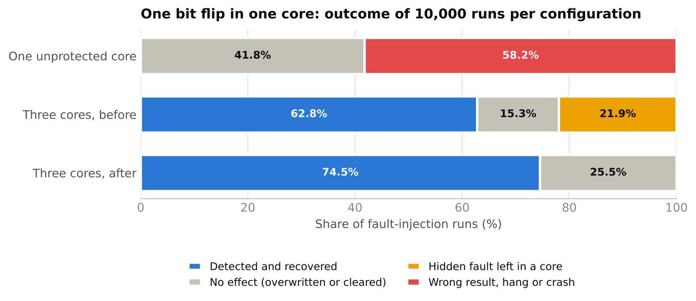
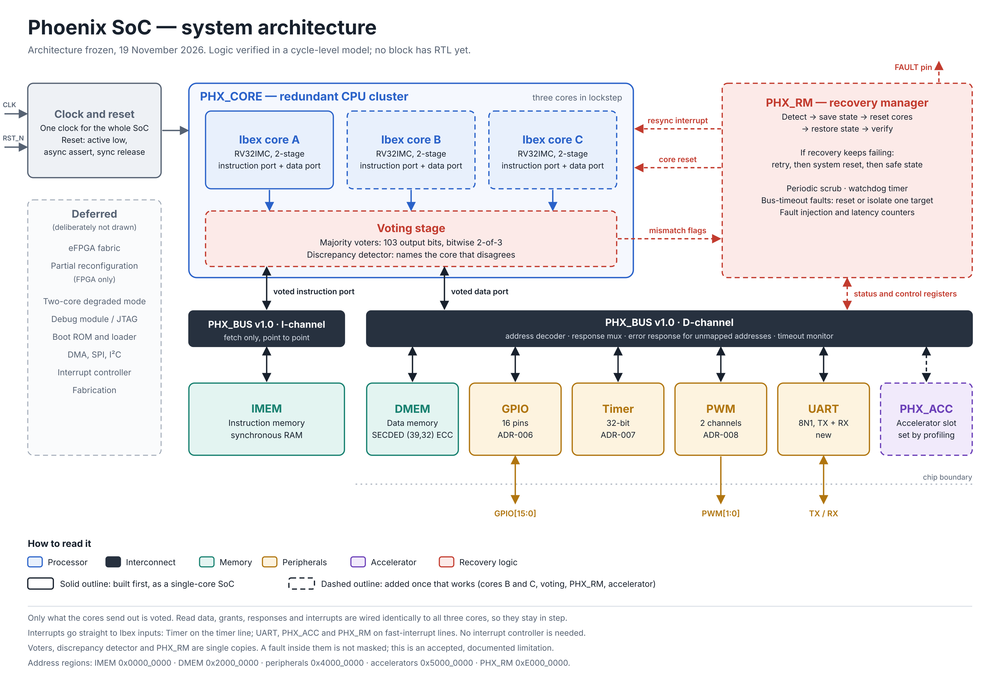
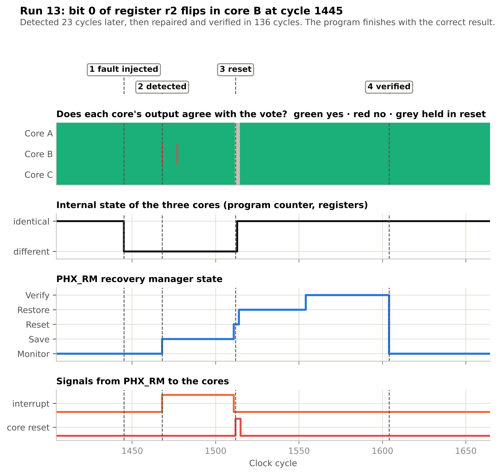

# Phoenix SoC

**A self-healing, triple-core RISC-V system-on-chip that repairs processor faults in about 136 clock cycles, without FPGA reconfiguration.**


A single radiation-induced bit flip can make an ordinary processor silently compute the wrong answer, hang or crash. **Phoenix eliminates those failures.** In 10,000 fault-injection runs, the same bit flips that broke an unprotected processor **58.2% of the time caused 0 failures in Phoenix**. It detected and repaired the faulty core in **74.5% of runs** while the program kept running. In the other 25.5% the flipped bit was never used, so there was nothing to repair. **Every run finished with the correct result.**

<p align="center">
  
</p>
<p align="center"><sub>The top bar is the unprotected single-core baseline that Phoenix is built to fix. The bottom bar is Phoenix with all protections on: no red (failures) and no orange (hidden faults).</sub></p>

---

## Key results

| Fault or measure | Baseline | **Phoenix (full design)** |
|---|---|---|
| Single bit flip in a core | Unprotected core: 58.2% wrong result, hang or crash | **0 failures in 10,000 runs**: 74.5% detected and repaired, 25.5% harmless |
| Single bit flip in data memory | Unprotected core: 70.1% wrong result | **0% wrong**: 64.2% corrected by ECC, the rest harmless |
| Faults left hiding in a core | Voting alone: 21.9% | **0%**, cleared by periodic scrubbing |
| Worst-case time to detect a fault | Voting alone: 1,869 cycles | **482 cycles**, about 4× faster |
| Faults in two cores at different times | Voting alone: 11.9% unresolved | **0% unresolved** |
| Time to repair a core | — | **136 clock cycles** (median); the program continues |
| Permanently stuck core | — | **100%** reach a defined safe state, with no reset loops |

**How Phoenix compares with the state of the art.** The self-healing RISC-V design that Phoenix builds on [[2]](#references) repairs a faulty core by reprogramming part of the FPGA, which takes **40–65 ms** per repair and works only on an FPGA. Phoenix repairs the core through a **save–reset–restore sequence** in about 136 cycles. It needs no reconfiguration, so the same design also works on an ASIC.

Every number above comes from a reproducible 68,400-run campaign (fixed seed 2026), built in three independent implementations: **Python, MATLAB and Simulink**. The three agree exactly, on 5,640 of 5,640 replayed runs and 52 of 52 test cases.

---

## How it works

<p align="center">
  
</p>

Phoenix runs **three Ibex RISC-V cores** in lockstep on the same program:

1. **Mask.** A bitwise majority voter on all 103 core output bits passes the 2-of-3 answer to the rest of the chip every clock cycle. A faulty core is outvoted, and memory never sees its wrong value.
2. **Detect.** A discrepancy detector names the core that disagreed.
3. **Repair.** The recovery manager, **PHX_RM**, saves the majority-voted state, resets all three cores, restores the saved state and verifies agreement for 50 cycles. The program then continues from where it was, with no progress lost.
4. **Escalate safely.** If repair keeps failing, PHX_RM retries, then performs a system reset, then enters a defined safe state and raises a FAULT pin. A permanent fault can never cause an endless reset loop.

Three standard protections close the gaps that voting alone cannot see:

- **Periodic scrub.** A routine save–restore that clears faults hiding in registers that are never read again. This took hidden faults from 21.9% to 0.
- **SECDED (39,32) ECC on data memory.** All three cores read the same memory, so ECC protects it. It corrects every single-bit memory error.
- **Watchdog.** It catches a program that a fault has sent into a loop, and escalates straight to a system reset.

### A repair, cycle by cycle

<p align="center">
  
</p>

In run 13, one bit of a register flips in core B at cycle 1445. The voter hides the error immediately. The detector flags core B 23 cycles later, when the wrong value first reaches its output. PHX_RM then saves, resets, restores and verifies, and the cores are back in lockstep 136 cycles after detection. The program finishes with the correct result. Run on a single core, the same bit flip silently corrupts 14 of the program's 60 stored results.

---

## Results by fault type

| Fault injected (runs) | One unprotected core | Phoenix: voting and recovery | **Phoenix: with scrub, ECC and watchdog** |
|---|---|---|---|
| One bit flip in one core (10,000) | 58.2% wrong, hang or crash | 0 wrong; 62.8% recovered, 21.9% hidden fault | **74.5% recovered, 25.5% no effect, 0 unresolved** |
| One bit flip in data memory (4,000) | 70.1% wrong | 70.1% wrong (voting can't protect shared memory) | **64.2% corrected by ECC, 35.8% no effect** |
| Two bit flips in one memory word (1,000) | — | 68.1% wrong | **57.1% correct after system reset, 35.6% no effect, 7.3% flagged by ECC** |
| Two cores hit at different times (3,000) | — | 77.3% recovered, 11.9% unresolved | **92.1% recovered, 0 unresolved** |
| Two cores hit within 3 cycles (3,000) | — | 66.1% recovered, 12.8% unresolved | **73.0% recovered, 0.5% unresolved** |
| Permanent fault in one core (200) | — | 100% safe state | **100% safe state** |

"No effect" means the flipped bit was overwritten or never used, so the result was correct without any repair.

Two points stand out:

- **Voting and recovery alone already removed every wrong output from single-core faults.** The three protections then removed the faults that were still hiding.
- **The one remaining case is a known limit of all triple-voting systems.** When two cores fail within 3 cycles of each other, two of the three cores can be wrong at the same moment and outvote the good one. Phoenix keeps this to 0.5%.

More charts, including detection-latency distributions, the scrub-period trade-off and every fault class, are in [`docs/figures/model/`](docs/figures/model/).

---

## Scope of these results

Phoenix's architecture is frozen, and its recovery logic is **verified in a cycle-level pre-RTL model**. That model uses a small stand-in core that talks to the bus the same way Ibex does. It is not Ibex RTL, an FPGA or silicon, so cycle counts apply to the stand-in core. The scrub also has a cost: at the chosen period it adds 21.7% run time on this short test program, and the cost is expected to be lower on longer programs. The next steps are writing the RTL and repeating the same fault campaign on an FPGA. See the [roadmap](ROADMAP.md) and the [pre-RTL verification report](docs/reports/Phoenix_PreRTL_Verification_Report.pdf) for the full method and its limits.

---

## Repository contents

```
docs/
  Phoenix_SoC_Engineering_Bible_Edition_3.(docx|pdf)   full engineering reference
  ENGINEERING_BIBLE.md                                   the same, in Markdown
  adr/                     Architecture Decision Records ADR-001 to ADR-020
  reports/                 pre-RTL architecture verification report
  figures/                 architecture diagrams and result charts
model/
  python/                  cycle-level model, fault campaign, charts, published results
  matlab/Phoenix_MATLAB/   MATLAB re-implementation and Simulink block-model builder
  viewer/                  interactive 3D view of the architecture (open in a browser)
tools/diagrams/            scripts that draw the architecture figures
ROADMAP.md                 what is done and what is next
```

**Interactive 3D model.** Download [`model/viewer/Phoenix_SoC_3D_Model.html`](model/viewer/Phoenix_SoC_3D_Model.html) and open it in a browser to explore the architecture.

---

## Reproduce the results

The model needs Python 3.8+ and nothing else; the charts also need `matplotlib`.

```bash
cd model/python
python3 phoenix_model_v2.py --scale 0.05 --out quick_check.json   # quick check, about a minute
python3 phoenix_model_v2.py --scale 0.5                            # full published campaign (68,400 runs, seed 2026)
python3 make_charts.py                                              # redraw the charts
```

The seed is fixed, so every run repeats exactly. For MATLAB and Simulink, see [`model/matlab/Phoenix_MATLAB/README.txt`](model/matlab/Phoenix_MATLAB/README.txt).

---

## Roadmap

- [x] Architecture frozen: ADR-001 to ADR-020
- [x] Cycle-level model and 68,400-run fault campaign
- [x] Independent MATLAB and Simulink implementations that match the Python model exactly
- [x] Scrub, ECC and watchdog added, each with its effect measured
- [ ] Block specifications: PHX_BUS, PHX_CORE, PHX_RM, peripherals
- [ ] SystemVerilog RTL: single-core SoC first, then three cores with PHX_RM
- [ ] **Track A:** FPGA prototype with an on-board fault-injection campaign
- [ ] **Track B:** RTL-to-GDSII flow in the SAED 32 nm educational library
- [ ] Journal paper (in preparation)

Details are in [ROADMAP.md](ROADMAP.md).

---

## Team

**Harit Patel** and **Mokshit Lattha**, Department of Electronics & Communication Engineering, Pandit Deendayal Energy University, Gandhinagar, India.  
Mentored by **Dr. Gunjan Thakur**.

---

## References

1. P. D. Schiavone et al., "Arnold: An eFPGA-Augmented RISC-V SoC for Flexible and Low-Power IoT End Nodes," *IEEE Transactions on Very Large Scale Integration (VLSI) Systems*, vol. 29, no. 4, 2021. DOI: [10.1109/TVLSI.2021.3058162](https://doi.org/10.1109/TVLSI.2021.3058162)
2. J. Cano-Páez et al., "Self-Healing Architecture for RISC-V Soft Core Processor in SRAM-Based FPGAs Using Dynamic Partial Reconfiguration," *IEEE Transactions on Nuclear Science*, vol. 73, no. 8, 2026. DOI: [10.1109/TNS.2026.3678753](https://doi.org/10.1109/TNS.2026.3678753)
3. lowRISC Ibex RISC-V core: <https://github.com/lowRISC/ibex>

Phoenix replaces Arnold's eFPGA [1] with a fixed accelerator slot, and replaces the partial reconfiguration of [2] with a save–reset–restore repair that also works on an ASIC.

---

## License

A license has not been chosen yet. Until one is added, all rights are reserved by the authors.
