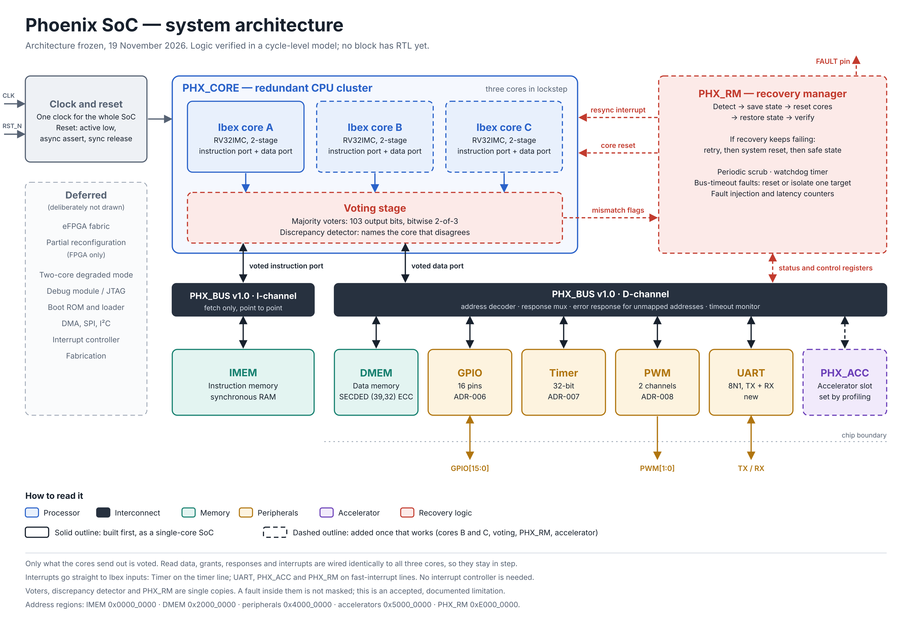
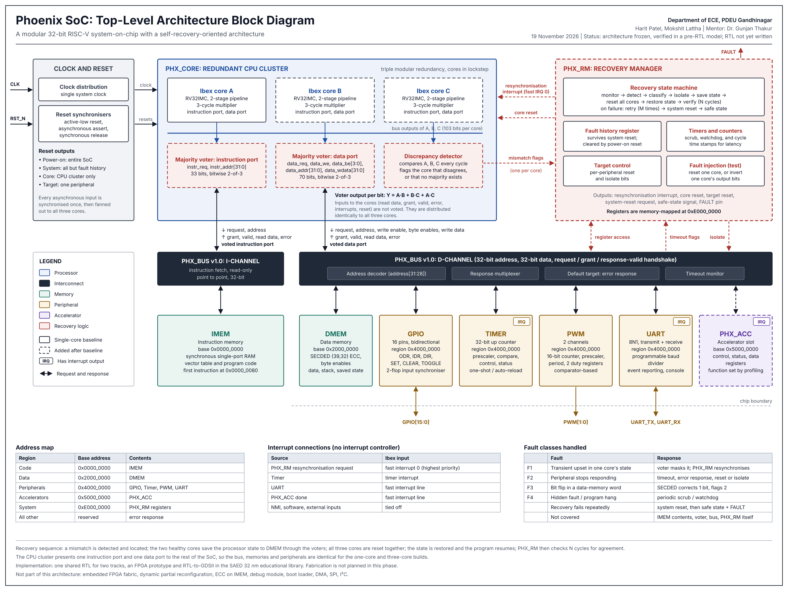
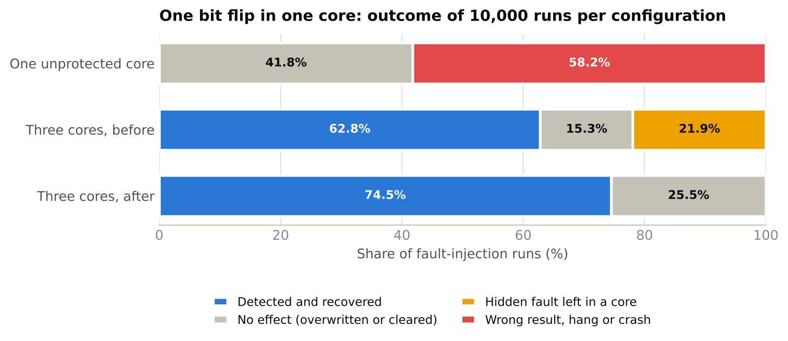
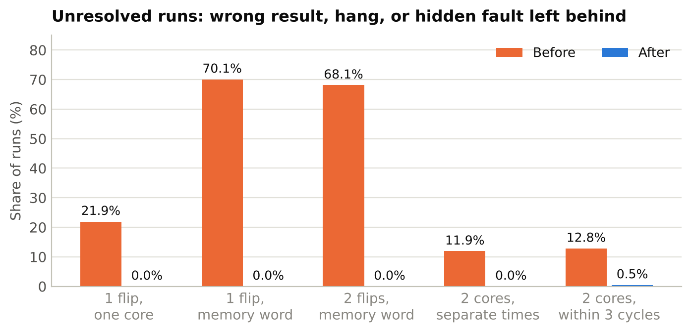
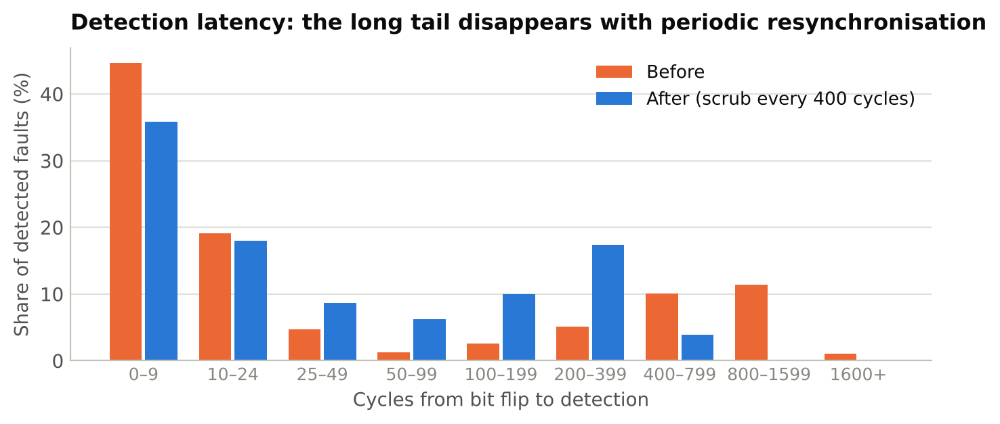
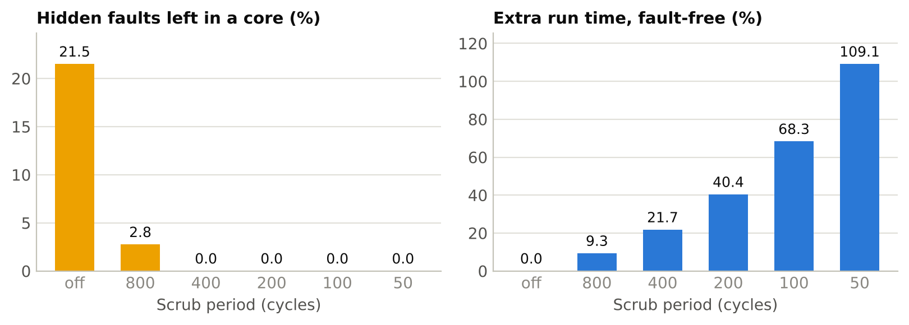
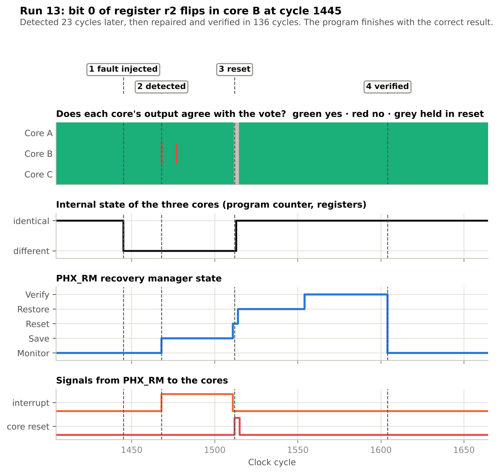
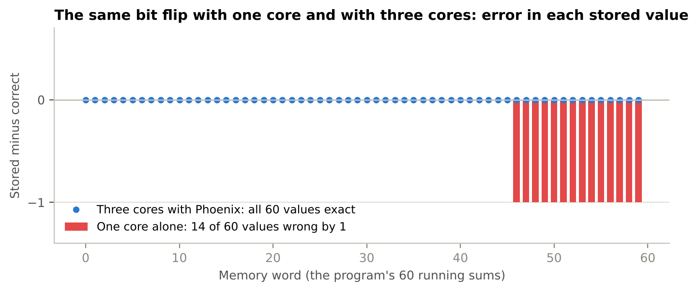
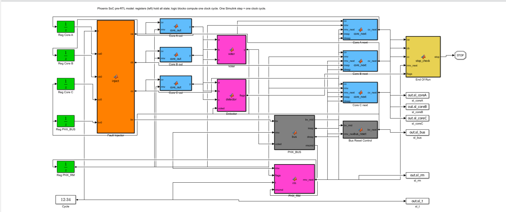

**Authors:** Harit Patel and Mokshit Lattha, Department of Electronics and Communication Engineering, Pandit Deendayal Energy University (PDEU), Gandhinagar, India. **Mentor:** Dr. Gunjan Thakur.

> *Understand the block. Understand its interface. Then earn the right to integrate it.*

# A note before you begin

This is the engineering reference for Phoenix SoC. It explains what Phoenix is, why it is built the way it is, what has been decided, what has been checked, and what comes next. It is written so that someone who was not in any of the design discussions can pick up the project and understand every important choice.

Edition 2 (30 October 2026) described a project whose CPU, bus, memory map and recovery mechanism were still open. Since then the architecture has been **completed, tested in an executable model and frozen for RTL**. Edition 3 replaces Edition 2 and records that state.

**What changed since Edition 2**

| Area | Edition 2 (30 Oct 2026) | Edition 3 (20 Nov 2026) |
|---|---|---|
| CPU | Ibex the leading candidate | Ibex "small" (RV32IMC, 2-stage), **decided**; three copies in lockstep |
| PHX_BUS | Custom bus, protocol open | **PHX_BUS v1.0**: Ibex-native request / grant / response-valid handshake, separate I-channel and D-channel, error response, timeout monitor |
| Memory map | Organisation intended, addresses open | Regions **decided**: 0x0000_0000 / 0x2000_0000 / 0x4000_0000 / 0x5000_0000 / 0xE000_0000 |
| Reset and interrupts | Open contract | One clock; active-low reset, asynchronous assert, synchronous release; four reset domains; interrupts wired straight to Ibex |
| Peripherals | GPIO, Timer, PWM | GPIO, Timer, PWM and **UART** |
| Accelerator | Extension, workload open | **PHX_ACC** slot replaces Arnold's eFPGA; function chosen by profiling (still open) |
| Recovery | Research direction | **PHX_CORE** (three Ibex, voters, detector) and **PHX_RM** (save, reset, restore, verify; retry, system reset, safe state) |
| Protection | Not defined | **Periodic scrub, SECDED on data memory, watchdog** |
| Evidence | None | Pre-RTL model in Python, MATLAB and Simulink: **68,400 fault-injection runs**, three implementations agreeing exactly |
| Implementation | FPGA-first, ASIC-aware | Two tracks from one RTL: **FPGA prototype and results paper**, and **RTL-to-GDSII in SAED32** |

> **Truthfulness rule.** A decided block is not an implemented block. A block that works in a model is not a block that works in silicon. Phoenix has **no RTL yet**. Every result in this Bible comes from a cycle-level model with a small stand-in core, not from Ibex, an FPGA or a chip.

**Companion documents**

- **Architecture Decision Records (ADR), revised 19 November 2026.** The formal authority for every decision: ADR-001 to ADR-020. This Bible explains the decisions; it does not replace them. Where the two differ, the ADR wins.
- **Pre-RTL Architecture Verification Report, revised 17 November 2026.** The full method and results of the model campaign.
- **Architecture figures:** the system architecture figure and the top-level block diagram, both dated 19 November 2026.
- **Model source code:** Python model, MATLAB re-implementation and Simulink block model.

## Status vocabulary

Every statement about Phoenix carries one of these labels, or is clearly a fact about the outside world.

| Label | Meaning |
|---|---|
| **Decided** | Recorded in an ADR and confirmed by the project owners. |
| **Proposed** | Suggested, not yet accepted. |
| **Under evaluation** | Alternatives are still being compared. |
| **Open** | A decision or a fact is still missing. |
| **Verified (model)** | Passed in the pre-RTL models. Says nothing about RTL or hardware. |
| **Implemented** | RTL exists at a named revision. *Nothing is implemented yet.* |
| **Verified** | A defined test on RTL or hardware passed and the evidence is kept. *Nothing is verified in this sense yet.* |
| **Planned** | Intended future work in the build order. |
| **Deferred** | Deliberately postponed beyond this phase. |

## How this Bible is organised

- **Part I, Identity:** what Phoenix is, why it exists, and how the idea evolved.
- **Part II, Background:** the two base papers, and the fault-tolerance ideas Phoenix is built on, taught from first principles.
- **Part III, Architecture:** every block, as frozen on 19 November 2026.
- **Part IV, Pre-RTL verification:** the model, the campaign, the results and their limits.
- **Part V, Research position:** comparison with the base paper, what can and cannot be claimed, and the novelty.
- **Part VI, Implementation plan:** the two tracks, the build order and the verification plan for RTL.
- **Part VII, Engineering discipline:** the working rules that keep the project honest.
- **Appendices:** glossary, formula sheet, key numbers, a worked fault walkthrough, open items, status snapshot and references.

# PART I — IDENTITY, PURPOSE AND EVOLUTION

## 1. Phoenix in one clear picture

Phoenix is a modular 32-bit RISC-V system-on-chip (SoC). It contains a processor, memories, an interconnect, memory-mapped peripherals and a slot for an application-specific accelerator. Its research feature is **self-recovery**: when a radiation-style fault corrupts one processor core, Phoenix detects it, masks it, repairs the core and checks that the repair worked, while the program carries on.



**Mission statement.** Build a modular 32-bit RISC-V SoC that shows disciplined architecture and verification, and that recovers from transient faults in its processor without reprogramming any hardware.

**The three identities**

| Identity | What it means | What it does not mean |
|---|---|---|
| Complete SoC | CPU, memory, bus and peripherals with defined contracts between them. | A slide with boxes and arrows. |
| Modular platform | Each block has one job, a fixed interface and can be replaced. | Every block written from scratch. |
| Research vehicle | A platform for measuring fault detection and recovery. | A claim that the recovery already works in silicon. |

**The one-minute pitch**

> Chips in space, cars and medical devices get hit by radiation. A single particle can flip one bit inside a processor, and the program silently produces a wrong answer. In our model, one flipped bit in an ordinary single-core system caused a wrong result, a hang or a crash in **58% of cases**.
>
> Phoenix runs **three Ibex RISC-V cores** on the same program at the same time. Every clock cycle a voter takes the majority answer, so one bad core is simply outvoted. A detector names the core that disagreed. The recovery manager, PHX_RM, then repairs it in about **136 clock cycles** in the model: it saves the good state, resets all three cores, restores them, and checks them for 50 cycles.
>
> The base paper repairs a bad core by reprogramming the FPGA, which takes about **40 milliseconds**. Our repair needs no FPGA, so it works on an ASIC too. With three standard protections added (scrubbing, ECC memory and a watchdog), **74.5%** of single-core faults were repaired, the other 25.5% had no effect, and **none of 10,000** runs ended badly. In the model.

## 2. Why Phoenix exists

Phoenix grew out of a wish to move beyond isolated RTL exercises and learn what it really takes to design, integrate, verify and implement a complete SoC. The value is not only the final RTL. It is the system-level loop: choose a block, understand its contract, integrate it with its neighbours, test normal and abnormal behaviour, and keep the evidence.

| Local-block thinking | System-level thinking |
|---|---|
| Does this module compile? | Does it meet its interface contract inside the system? |
| Does the register change? | Can the CPU address it, write it, read it and see defined reset values? |
| Does the timer count? | Are clock, reset, prescaler, compare and interrupt behaviour coherent? |
| Does the recovery FSM reach DONE? | Was a defined fault detected, isolated, repaired and the repair checked? |
| Did synthesis finish? | What do the constraints, warnings, timing and area reports say? |

The research question came later and gave the project its identity. Reliable processors for harsh environments usually rely either on radiation-hardened processes, which are expensive, or on FPGA reconfiguration, which only works on FPGAs. Phoenix asks whether a small, standard-cell SoC can recover from processor faults using nothing but redundancy, voting and a careful recovery sequence.

## 3. One SoC, built incrementally

Phoenix is **one architecture**, not a sequence of products called V1, V2 and V3. The build is staged, but every stage builds the same system. The CPU cluster, for example, has a build parameter: it can be built with one core (voters bypassed) or with three. Nothing outside the cluster changes between the two. The first working system is the single-core build; the three-core build is the same SoC with the redundancy switched on.

| Layer | Contents | How to describe it |
|---|---|---|
| Architecture (frozen) | Everything in Part III | "The Phoenix architecture" |
| First build step | Single-core SoC: one Ibex, PHX_BUS, memories, GPIO, Timer, PWM, UART | "The baseline integration milestone" |
| Later build steps | Bus timeout and PHX_RM; three cores and voters; protections; accelerator | "The next verified capability", never "Phoenix v2" |

## 4. How the vision evolved

| Date | What happened | Why it matters |
|---|---|---|
| July 2026 | Flagship modular SoC ambition; reuse IP where sensible | Founding philosophy |
| August 2026 | 32-bit RISC-V direction; custom bus and memory organisation; GPIO, timer, PWM | Platform direction |
| Late August 2026 | V1/V2/V3 roadmap framing rejected | One architecture, staged build |
| September 2026 | Phoenix itself named as the main contribution; self-recovery chosen as the research direction | Research identity |
| October 2026 | CPU candidates (PicoRV32, Ibex, CV32E40P) compared; first evaluation; ADR-001 to ADR-008 written | Baseline decisions |
| 31 October 2026 | Ibex confirmed as the CPU (ADR-009) | Interface of every other block now fixed by Ibex |
| 1 November 2026 | eFPGA replaced by a profiled, fixed-function accelerator slot (ADR-015) | Keeps what a standard-cell flow can build |
| 4–5 November 2026 | GF180 shuttle considered and deferred: the available slot (about 160 × 170 µm) is far too small. SAED32 chosen for RTL-to-GDSII (ADR-010) | Implementation target |
| 13 November 2026 | Complete architecture pass: PHX_BUS v1.0, memory, reset and interrupts, UART, three-core cluster, PHX_RM (ADR-011 to ADR-018) | Architecture defined |
| 13–17 November 2026 | Pre-RTL model and 68,400-run fault campaign; three weaknesses found and fixed; re-implemented in MATLAB and Simulink | Architecture logic checked |
| 19 November 2026 | Faculty review. Architecture frozen; protections accepted (ADR-019); two delivery tracks set (ADR-020) | Ready for RTL |

The broad ambition never changed. What changed is that each open question was answered in turn, and the answers were tested before any hardware was written.

# PART II — BACKGROUND

## 5. The two base papers

Phoenix combines ideas from two published designs. Their PDFs are not part of this repository; see the references in Appendix G.

### 5.1 Arnold: an eFPGA-augmented RISC-V SoC

**What it is.** Arnold (Schiavone et al., IEEE TVLSI, 2021) is a RISC-V microcontroller for low-power IoT end nodes. Next to its CV32E40P-class core it places an **embedded FPGA (eFPGA)**: a small block of reprogrammable logic on the chip itself. Software can load a hardware function into the eFPGA and use it to accelerate a task or to build a custom interface.

**Why it matters to Phoenix.** Arnold shows the value of moving the hottest computation out of software and into hardware sitting beside the CPU, with memory-mapped control and an interrupt on completion.

**What Phoenix does not take.** The eFPGA is a licensed hard macro. A standard-cell RTL-to-GDSII flow cannot produce one, and building an open-source eFPGA would be a project of its own. Phoenix therefore keeps the *idea* (hardware beside the CPU for the hot operation) and drops the *fabric*. Arnold also has an I/O DMA, multiple clock and power domains and body biasing; none of those are needed for Phoenix's research question.

### 5.2 The self-healing RISC-V architecture

**What it is.** Cano-Páez et al. (IEEE Transactions on Nuclear Science, 2026) build a fault-tolerant processor on an **SRAM-based FPGA** (Artix-7 XC7A100T) with three CV32E40P cores in lockstep, majority voters on their outputs, and a hardware recovery controller (a triplicated "hypervisor"). When one core disagrees, the controller **rewrites that core's region of the FPGA using Dynamic Partial Reconfiguration (DPR)**, then resynchronises it through an interrupt routine, checks agreement for N cycles and retries up to M times.

**Reported figures** (from the paper; quoted for comparison only):

| Measure | Value |
|---|---|
| Repair of one processing unit by DPR | 40.11 to 65.53 ms |
| Repair of the hypervisor by DPR | 12.95 to 20.1 ms |
| Fault-injection campaign | 93.99% non-disruptive, 100% total recovery |
| Proton-beam test | 95.34% non-disruptive, 99.94% total recovery, 1 silent data corruption |
| Causes of full reconfiguration | about 60% static logic, about 40% double-bit errors |
| Recovery parameters | N = 50 cycles, M = 3 attempts |

**Why it matters to Phoenix.** It is the direct ancestor of PHX_CORE and PHX_RM: three lockstepped cores, voting before the shared memory, a hardware recovery manager, resynchronisation through an interrupt, the N-cycle check and the M-attempt limit.

**Its dead end, for Phoenix's purposes.** DPR only exists on FPGAs and takes tens of milliseconds. On an ASIC there is no configuration memory to rewrite; a fault sits in flip-flops. Phoenix needs a repair that works there.

### 5.3 What Phoenix keeps from each

| Paper | Kept | Not carried over |
|---|---|---|
| Arnold | Hardware beside the CPU for the hottest operation; fixed arithmetic units; interrupt on completion; memory-mapped control | The eFPGA fabric; the I/O DMA; multiple clock and power domains; body biasing |
| Self-healing architecture | Three lockstepped cores; voters on the bus outputs; discrepancy detection; hardware recovery manager; resynchronisation through an interrupt routine; N-cycle check and M-attempt limit; shared memory with separate instruction and data ports; SECDED on data memory | Repair by partial reconfiguration; the triplicated hypervisor (Phoenix's PHX_RM is a single copy) |

**A common confusion, corrected.** The eFPGA belongs to **Arnold**, not to the self-healing paper. The self-healing paper uses an ordinary SRAM FPGA and DPR. Phoenix removed the eFPGA and put the PHX_ACC accelerator slot in its place.

## 6. Fault-tolerance foundations, from first principles

### 6.1 The problem: a bit flip

A register holds the number 5, binary `0101`. A charged particle strikes the flip-flop holding bit 3 and inverts it. The register now holds `1101`, which is 13. Nothing in an ordinary chip notices; the program carries on with 13. This is a **single-event upset (SEU)**: a *transient* fault. The circuit is not damaged; one stored value is wrong.

A **permanent** fault is different: a wire or transistor is broken, so a bit is stuck at 0 or 1 whatever happens. Rewriting the value does not help.

**How the model creates a bit flip: XOR.** XOR with a mask flips exactly the bits where the mask has a 1 and leaves the rest:

| x (stored bit) | m (mask bit) | x ⊕ m |
|---|---|---|
| 0 | 0 | 0 |
| 1 | 0 | 1 |
| 0 | 1 | 1 |
| 1 | 1 | 0 |

To flip bit *b* only, the mask is 2^b (a single 1 at position *b*). So 5 ⊕ 2³ = `0101` ⊕ `1000` = `1101` = 13. XOR flips in both directions, which is exactly what an upset does; OR would only model "stuck at 1" and AND only "stuck at 0". Flipping the same bit twice restores the value, since (x ⊕ m) ⊕ m = x.

### 6.2 Majority voting (TMR)

Three friends add up the same bill. Two say ₹450 and one says ₹540. You trust the two who agree. That is **triple modular redundancy (TMR)**: three copies and a majority vote.

For one bit, the output is 1 when at least two inputs are 1:

| A | B | C | Y |
|---|---|---|---|
| 0 | 0 | 0 | 0 |
| 0 | 0 | 1 | 0 |
| 0 | 1 | 0 | 0 |
| 0 | 1 | 1 | 1 |
| 1 | 0 | 0 | 0 |
| 1 | 0 | 1 | 1 |
| 1 | 1 | 0 | 1 |
| 1 | 1 | 1 | 1 |

Reading the four rows where Y = 1 and simplifying gives the voter equation **Y = A·B + B·C + A·C**: three two-input AND gates and one three-input OR gate per bit.

Worked example on 4 bits: A = `0101`, B = `1101` (the upset copy), C = `0101`. At bit 3 the inputs are 0, 1, 0, so the vote is 0. The output is `0101` = 5. The bad copy is outvoted and the rest of the system never sees 13.

**Why three and not two.** Two copies can tell that something is wrong but not *which* copy is wrong. The only safe response is to stop. Three copies can outvote one bad copy and keep running.

**How much safer.** If each copy is faulty with probability *p* during some interval, the voted result is wrong only if two or three copies are faulty:

P(fail) = 3p²(1 − p) + p³ ≈ 3p²

For *p* = 10⁻³: one copy fails with probability 10⁻³, the voted triple with about 3 × 10⁻⁶. That is roughly **330 times** better.

### 6.3 Detection: who disagreed?

The voter fixes the output but the bad copy still holds the wrong value inside. A **discrepancy detector** compares each copy with the vote: flag_k = (V_k ≠ Y). In the example, flag_B = 1. Now a recovery manager knows *which* copy to repair.

### 6.4 Lockstep

In **lockstep**, the copies run the same program on the same clock edge with identical inputs, so their outputs should match bit for bit on every cycle. Any difference is a fault. Industry examples include dual-core lockstep (DCLS) in safety microcontrollers such as the ARM Cortex-R5, and triple-core lockstep in research chips such as Trikarenos (three Ibex cores in 28 nm).

The catch: lockstep only works if every input reaches every copy on the same cycle. One unsynchronised input pin, sampled by two copies on different edges, makes them drift apart with no fault present. Phoenix's rule is therefore **synchronise once, then fan out** (Section 11).

### 6.5 Why repair is needed, and why a reset alone is not recovery

The voter hides a bad copy, but it does not fix it. If a second fault then hits a *different* copy, two of three are wrong and they outvote the healthy one. So the bad copy must be brought back into step, quickly.

A plain reset is not recovery. It throws away the program's progress, it does not know which block failed, and it does not check that the problem is gone. **Recovery** in Phoenix means: detect and locate the fault, save the correct state, reset, restore that state so the program continues where it stopped, verify that all copies agree again, and if that keeps failing, fall back to a defined safe state.

### 6.6 Hidden (latent) faults

If the flipped register is never read again, the bad copy never outputs a wrong value, so the voter never sees a difference. The fault is **latent**: harmless today, dangerous if a second fault later hits another copy. Latent faults are cleared by **scrubbing**: periodically rewriting state from a trusted source whether or not an error was seen. Memories and FPGA configuration memories are routinely scrubbed for the same reason.

### 6.7 Error-correcting codes (SECDED)

Three cores do not protect memory: all three read the *same* memory, so a flipped stored bit reaches all three and they agree on the wrong value.

The standard answer is an error-correcting code. **SECDED** (single error correct, double error detect) stores a few check bits with every word.

- **How many check bits.** A Hamming code for *m* data bits needs *r* check bits with 2^r ≥ m + r + 1. For m = 32, r = 6 works (64 ≥ 39). One more overall parity bit adds double-error detection: **7 check bits, 39 bits per word**, an overhead of 7/32 = 21.9%.
- **How it finds the bad bit.** Number the bit positions 1, 2, 3 and so on. In a valid codeword, the XOR of the positions of all 1-bits is 0. If bit 13 flips, that XOR (the *syndrome*) becomes 13. In binary 13 = `1101` = 8 + 4 + 1, so check bits 1, 4 and 8 fail together and point straight at position 13. Flip it back.
- **One error or two.** The overall parity bit decides. Odd parity with syndrome s ≠ 0: one error at position s, correct it. Even parity with s ≠ 0: two errors, flag them, never "correct" them. s = 0: no error.

### 6.8 Watchdog timers

A **watchdog** is a countdown that software must restart ("kick") regularly. If software stops kicking it, because a fault sent the program into a loop, the watchdog fires. It does not know *what* went wrong, only that the program stopped making progress. It catches failures that voters cannot see: for example a corrupted memory word that sends all three cores into the same endless loop, where they all agree.

### 6.9 Measuring fault tolerance

A **fault-injection campaign** flips chosen bits at chosen times and records what happens. The key measures are:

- **Outcome shares:** what fraction of runs recovered, had no effect, failed, and so on. Each run gets exactly one outcome, so the shares add up to 100%.
- **Detection latency** = t_detect − t_fault: how long the bad value stayed inside before it was seen.
- **Recovery time** = t_verified − t_detect: how long the repair took.
- **Confidence for zero failures:** with zero failures in *n* runs, the 95% upper bound on the true failure rate is about 3/n (the "rule of three"). For 10,000 runs, about 0.03%.

# PART III — THE PHOENIX ARCHITECTURE

*Frozen for RTL on 19 November 2026. Every item in this part is **Decided** unless marked otherwise. The ADR number in brackets is the formal record.*

## 7. System overview



| Block | Role | ADR | Build step |
|---|---|---|---|
| PHX_CORE | One or three Ibex cores, majority voters, discrepancy detector | 009, 016 | 1 (one core), 4 (three) |
| PHX_BUS v1.0 | I-channel (instruction fetch) and D-channel (data and peripherals) | 001, 011 | 1 |
| IMEM, DMEM | Instruction memory; data memory with SECDED | 003, 012, 019 | 1 (SECDED in 4) |
| Clock and reset | One clock; four reset domains | 013 | 1 |
| GPIO, Timer, PWM, UART | Peripherals | 005–008, 014 | 1 |
| PHX_RM | Recovery manager with scrub and watchdog | 017, 019 | 3 (bus faults), 4 (core faults) |
| PHX_ACC | Accelerator slot | 015 | 5 |

**The key structural idea.** To everything outside it, PHX_CORE looks like *one* CPU with one instruction port and one data port. The bus, the memories and the peripherals never know there are three cores. That is what lets Phoenix be built and verified first with one core, then switched to three without touching anything else.

## 8. The CPU: Ibex (ADR-009, ADR-016)

### 8.1 Why Ibex

The CPU had to do four things: fit separate instruction and data memories, run as three identical copies in lockstep, take standard RISC-V interrupts (recovery uses one), and stand comparison with the base papers.

| Candidate | Strength | Why not selected / why selected |
|---|---|---|
| PicoRV32 | Smallest; the team had already taken it through RTL-to-GDSII in SAED32 | One shared memory port; its own non-standard interrupt scheme; several cycles per instruction |
| CV32E40P | The core used in both base papers | Largest of the three, and that cost is paid three times in a triplicated cluster |
| **Ibex (selected)** | Two-stage RV32IMC; separate instruction and data ports; standard machine-mode interrupts with 15 fast interrupt inputs; documented "small" configuration; published triple-lockstep precedent (ODRG, Trikarenos) | Smallest core that meets all four requirements |

Choosing a different core from the papers is an advantage when presented properly: the self-healing paper states that its approach is not tied to one RISC-V implementation, and Phoenix tests that statement with Ibex.

### 8.2 Configuration

| Item | Setting |
|---|---|
| Instruction set | RV32IMC |
| Pipeline | Two stages |
| Multiplier | 3-cycle |
| Physical memory protection | Off |
| Instruction cache | Off |
| SecureIbex (built-in dual lockstep and integrity bits) | Off |
| Register file | Flip-flop version for SAED32; FPGA version on FPGA |
| Debug request, NMI, software and external interrupt inputs | Tied off |
| Source | Unmodified, from one pinned commit of the lowRISC repository |

**Why SecureIbex is off.** Its lockstep adds one shadow core and raises an alert when the two disagree. Two cores can show that something is wrong but not which one, so they cannot outvote a fault. Phoenix needs three.

**Important: Ibex is a 32-bit core.** Its registers and datapath are 32 bits wide. The "103 bits" in Section 13 is the number of *output wires* the voter covers, not the width of the core.

## 9. PHX_BUS v1.0 (ADR-001, ADR-011)

### 9.1 What was decided

ADR-001 decided that Phoenix has its own simple, memory-mapped bus. ADR-011 decided what that bus is.

| Topic | Decision |
|---|---|
| Handshake | Address phase (request, grant) and response phase (response-valid, read data, error flag). The same handshake family as Ibex's memory interface, so no bridge is needed. |
| Topology | Two channels, one per Ibex port. **I-channel:** point to point from the voted instruction port to IMEM, read-only. **D-channel:** from the voted data port through an address decoder and response multiplexer to DMEM, peripherals, accelerator region and PHX_RM. |
| Masters | One per channel. No arbiter. |
| Widths | 32-bit address, 32-bit data, four byte enables on the D-channel. One clock. |
| Decoding | Top four address bits only, addr[31:28]. |
| Error response | An unmapped address is answered by a default target with the error flag set; Ibex raises an access-fault exception. |
| Wait states | A target may delay its grant or its response. Memories and baseline peripherals respond one cycle after the grant. Responses return in request order. |
| Timeout (D-channel) | If a granted request gets no response within a programmable number of cycles, the interconnect completes it with an error and reports the target to PHX_RM. One stuck peripheral cannot freeze the processor. |

### 9.2 Why this handshake

| Option | Best throughput | Logic between Ibex and bus | Verdict |
|---|---|---|---|
| APB | One transfer every two cycles | Bridge | Too slow for memory and fetch |
| AHB-Lite | One per cycle | Bridge, plus transfer-type and size signalling | More protocol than needed |
| AXI4-Lite | One per cycle | Bridge to five channels | Most area and verification work |
| Wishbone | One per one or two cycles | Small adapter | Offers nothing over the native handshake |
| **Ibex-native (selected)** | One per cycle | None | Fastest and smallest for this CPU |

Two channels instead of one shared bus means fetch and data access never wait for each other and need no arbiter. Arnold needs a crossbar because several masters share its memory; Phoenix has one master per channel.

### 9.3 Still to be written in the PHX_BUS v1.0 specification

This is the **next document** of the project. It must fix: the signal list with names, widths, directions and reset values; cycle-by-cycle timing diagrams for read, write, wait states and error; the rule that keeps responses in order; the timeout register; and the extra cycle needed for byte and halfword stores to ECC-protected DMEM (Section 10.4).

**Timing caution already known.** Ibex has a combinational path from its data response-valid input to its data request output (lowRISC/ibex issue 2258). Targets must drive response-valid and read data from registers.

### 9.4 A read, cycle by cycle (illustrative)

The cycle pattern below follows the decided behaviour ("response one cycle after grant"). Signal names are placeholders until the specification fixes them.

| Cycle | Core (master) | Interconnect / target | Meaning |
|---|---|---|---|
| T0 | Raises request with address 0x2000_0010, write enable 0 | Decoder sees addr[31:28] = 0x2, selects DMEM; DMEM grants | Address phase completes in one cycle |
| T1 | May present a new request | DMEM drives response-valid = 1 with the read data, error = 0 | Response phase |
| T2 | Data written into the destination register | — | Load retires |

An access to 0x7000_0000 instead would select the default target in T0 and return response-valid with error = 1 in T1; Ibex then takes a load access fault.

## 10. Memory and address map (ADR-003, ADR-004, ADR-012, ADR-019)

### 10.1 Address regions

| Region | Base address | addr[31:28] | Contents |
|---|---|---|---|
| Code | 0x0000_0000 | 0x0 | IMEM: vector table and program |
| Data | 0x2000_0000 | 0x2 | DMEM: data, stack, recovery save area |
| Peripherals | 0x4000_0000 | 0x4 | GPIO, Timer, PWM, UART |
| Accelerators | 0x5000_0000 | 0x5 | PHX_ACC |
| System | 0xE000_0000 | 0xE | PHX_RM registers |
| Everything else | — | — | Reserved; error response |

The layout follows the familiar Cortex-M organisation: code at the bottom, RAM at 0x2000_0000, peripherals at 0x4000_0000, system control at 0xE000_0000. This is an *organisational* choice only; Phoenix runs the RISC-V instruction set. Because every region differs in its top four bits, the decoder compares four bits and stays shallow.

**Start of execution.** Ibex's boot address input is tied to 0x0000_0000. Ibex puts its vector table in the first 0x80 bytes and fetches its first instruction from **0x0000_0080**.

**Open:** the base address of each peripheral inside the peripheral region is an integration-specification item. The sizes of IMEM and DMEM are parameters until the SAED32 SRAM macros are listed (Appendix E).

### 10.2 Memory structure

IMEM and DMEM are separate synchronous single-port RAMs. IMEM is read through the I-channel; DMEM has byte enables on the D-channel. Both are **preloaded**: by the testbench in simulation, by the bitstream on FPGA. A boot ROM with a UART loader is deferred together with fabrication.

The memories are **not triplicated**. As in the self-healing paper, the three cores share one memory and the voters stop a faulty core from writing to it.

### 10.3 The memory wrapper

Both memories sit behind one wrapper module with a fixed interface. Inside it is a block RAM on FPGA, an SRAM macro in SAED32, or a behavioural array in simulation. Everything technology-specific about memory lives inside the wrapper, so the bus and cores are identical on every target.

### 10.4 SECDED on DMEM (ADR-019)

Each 32-bit DMEM word is stored with 7 check bits, 39 bits in total, encoded and decoded inside the wrapper.

| Event on read | Response |
|---|---|
| No error | Data returned |
| One bad bit | Corrected data returned; corrected word written back to memory; PHX_RM counts the event |
| Two bad bits | Not corrected. The D-channel returns an error response and PHX_RM is told |

**Consequences to handle in the specifications.** A byte or halfword store must read the word, merge the new bytes, re-encode and write back: at least one extra cycle for sub-word stores. Each DMEM word is 39 bits wide; how that maps onto the SAED32 macros and the FPGA block RAM is a memory-specification item. IMEM is not protected in this phase.

## 11. Clock, reset and interrupts (ADR-013)

**Clock.** One clock drives every block. No clock-domain crossings.

**Reset.** Active low, asserted asynchronously, released synchronously through a two-flop synchroniser per domain. This matches Ibex's own reset input.

| Reset | Asserted by | Resets |
|---|---|---|
| Power-on | External pin | Everything, including PHX_RM's fault history |
| System | Power-on, or PHX_RM escalation | Everything except PHX_RM's fault history |
| Core | System reset, or PHX_RM during recovery | The CPU cluster only; memories, peripherals and PHX_RM keep running |
| Target (one per D-channel peripheral) | System reset, or a PHX_RM control bit | That one peripheral |

**Lockstep rule: synchronise once, then fan out.** Reset release, external inputs (GPIO, UART receive) and interrupt lines are each synchronised a single time, and the same registered signal goes to all three cores. All three cores get the same hart ID and boot address.

**Interrupts.** No interrupt controller; sources connect directly to Ibex.

| Source | Ibex input |
|---|---|
| PHX_RM resynchronisation request | Fast interrupt 0 |
| Timer | Timer interrupt |
| UART | A fast interrupt line |
| PHX_ACC done | A fast interrupt line |
| NMI, software and external inputs | Tied off |

Lines are level-sensitive: a source holds its line until software clears the cause. GPIO and PWM have no interrupt output. Exact line numbers for UART and PHX_ACC are an integration-specification item.

**Why recovery uses a maskable interrupt, not the NMI.** An NMI can arrive while the program is already inside a trap handler. Ibex keeps the interrupted handler's return state in internal registers software cannot read, so that state could not be saved and would be lost at reset. A maskable interrupt is taken only when interrupts are enabled, when everything needed to resume is in ordinary registers. The cost is that recovery waits until interrupts are enabled; PHX_RM puts a timeout on that wait.

## 12. Peripherals (ADR-005 to ADR-008, ADR-014)

All peripherals are memory-mapped targets on the D-channel in the 0x4000_0000 region. Offsets below are *within* each peripheral; peripheral base addresses are still to be assigned.

### 12.1 GPIO (ADR-006)

16 bidirectional pins with a direction register.

| Offset | Register | Description |
|---|---|---|
| 0x00 | ODR | Output Data Register: the value software wants to drive |
| 0x04 | IDR | Input Data Register: the logic level actually present on the pins |
| 0x08 | DIR | Direction: 0 = input, 1 = output |
| 0x0C | SET | Writing 1 sets the selected output bits |
| 0x10 | CLEAR | Writing 1 clears the selected output bits |
| 0x14 | TOGGLE | Writing 1 toggles the selected output bits |

ODR always stores what software wrote, whatever the direction; DIR alone decides whether it is driven onto the pin. IDR always reflects the pins, independent of ODR. Reading ODR and reading IDR are therefore different things: the commanded value versus the observed value. Inputs pass through a two-flop synchroniser. Still to specify: reset values, behaviour of the upper 16 bits, and access rules for SET, CLEAR and TOGGLE.

### 12.2 General-purpose timer (ADR-007)

One 32-bit up-counter with a programmable prescaler, a compare register, a control register (enable, auto-reload) and a status register.

Timer clock = System clock / (PRESCALER + 1), so PRESCALER = 0 means divide by 1.

| Auto-reload | When the counter reaches COMPARE |
|---|---|
| 0 (one-shot) | Status flag set; counter stops |
| 1 (periodic) | Status flag set; counter resets to 0 and continues |

Worked example at an assumed 50 MHz: PRESCALER = 49 gives a 1 MHz tick (1 µs); COMPARE = 999 then gives a flag every 1,000 ticks, i.e. every 1 ms, if the compare convention counts 0 to 999. That convention is a specification item. The status flag drives Ibex's timer interrupt.

### 12.3 PWM (ADR-008)

A dedicated PWM peripheral, independent of the timer: two channels sharing one 16-bit up-counter, a programmable prescaler, a programmable period register and one duty register per channel. Each output is comparator-based:

if (Counter < Duty) PWM_Output = HIGH; else PWM_Output = LOW;

Example: period 1,000 ticks, duty 250, tick 2 µs → period 2 ms, frequency 500 Hz, high time 500 µs, duty cycle 25%. Still to specify: whether the period register holds N or N − 1, behaviour at duty = 0 and duty > period, and when new values take effect. In the safe state, PWM outputs are forced low.

### 12.4 UART (ADR-014)

8 data bits, no parity, 1 stop bit (8N1), programmable baud divider, transmit and receive, one interrupt line. It was deferred in ADR-005 and brought back because the recovery research must report detection and recovery events off-chip (the self-healing paper does the same over UART), and the FPGA prototype needs a console. Its register map belongs to the UART specification.

SPI, I²C, DMA and an interrupt controller remain deferred.

## 13. PHX_CORE: the redundant CPU cluster (ADR-016)

### 13.1 Structure

Three identical, unmodified Ibex cores share one clock and receive identical inputs on the same cycle. A **majority voter** sits on every signal the cores send to the bus; signals going *into* the cores are not voted but fanned out to all three.

| Port | Voted signals | Bits |
|---|---|---|
| Instruction | instr_req (1), instr_addr (32) | 33 |
| Data | data_req (1), data_we (1), data_be (4), data_addr (32), data_wdata (32) | 70 |
| **Total** | | **103** |

Each bit is voted separately with Y = A·B + B·C + A·C: 103 small majority gates.

A **discrepancy detector** compares the three sets of outputs every cycle and raises one flag per core, plus a "no majority" flag if all three differ. The flags go to PHX_RM. The voters and detector are single copies.

A build parameter selects **one core** (voters bypassed) or **three**; nothing outside PHX_CORE changes.

### 13.2 Why vote at the cluster boundary

| Alternative | Problem |
|---|---|
| One core, reset on error | Nothing detects the error; a reset loses program state |
| Two cores in lockstep | Detects but cannot tell which core is wrong |
| **Three cores, voting at the bus boundary (selected)** | Redundancy stays inside one block |
| Three cores each with its own bus, voting at every target | Triplicates the bus and every target interface |
| Triplicating every flip-flop inside one core | Needs a modified core or special synthesis flow; loses the clean block boundary |

Voting on the outputs leaves Ibex untouched. The price is that a wrong bit *inside* a core stays invisible until it reaches an output: the latent faults that the scrub handles.

### 13.3 Cost

The voter adds a few gate delays and no clock cycles on the path from the cores to the bus. If that path limits the clock frequency, a register can be added after the voter at the cost of one cycle. The area cost is mostly the two extra cores; published work on Ibex triplication (ODRG) reports its voting and control logic at under 11% of one core.

### 13.4 Limits (stated as part of the decision)

- A fault in the voters or the detector is not masked.
- Faults that hit all three cores the same way (clock, reset, memory contents, a design bug) are not masked by voting.
- An upset in an unused register stays hidden until it reaches an output.
- **Open for the PHX_CORE specification:** Ibex has outputs other than the two memory ports (for example sleep, alert and crash-dump signals). The specification must list every one and state whether it is voted, compared, taken from one core or left unconnected.

## 14. PHX_RM: the recovery manager (ADR-017, ADR-019)

### 14.1 Fault model

| Label | Fault | How it shows | Handled by |
|---|---|---|---|
| F1 | Transient upset in one core's internal state | That core's outputs differ from the other two | Voter masks; PHX_RM resynchronises |
| F2 | A D-channel target stops responding | A granted request gets no response | Bus timeout; reset or isolate the target |
| F3 | Bit flip in a stored DMEM word | — | SECDED corrects one, flags two |
| F4 | Hidden fault in a core, or a hang affecting all cores | Nothing, or no progress | Periodic scrub; watchdog |
| — | Permanent fault in one core | Mismatch returns after every repair | Escalation to safe state |

F1 and F2 are the labels used in ADR-017; F3 and F4 are the labels this Bible and the block diagram use for the classes added by ADR-019.

**Not handled:** upsets in IMEM; faults in the voters, detector, bus or PHX_RM itself; faults common to all three cores; software bugs.

### 14.2 Recovery sequence for F1

1. **Monitor.** PHX_RM watches the detector flags.
2. **Detect.** A flag rises for one core.
3. **Classify.** One core disagreeing is recoverable. More than one, or no majority, goes straight to escalation.
4. **Isolate.** The voter is already outvoting the faulty core. PHX_RM ignores that core's flag until recovery ends and keeps comparing the two healthy ones.
5. **Save.** PHX_RM raises the resynchronisation interrupt (fast IRQ 0). The handler pushes the 31 integer registers and the machine-mode registers it needs onto the stack *through the voted data port*, so only the majority's values reach memory. It then writes the stack pointer to a PHX_RM register, meaning "state saved".
6. **Reset.** PHX_RM waits for the bus to be idle and asserts core reset to all three cores together.
7. **Restore.** The cores leave reset on the same cycle in the same state. Start-up code reads the PHX_RM register: a saved stack pointer means "resume", so the registers are reloaded and the program returns to where it was interrupted. Zero means a normal cold start.
8. **Verify.** Software clears the register. PHX_RM watches N cycles for any mismatch. None: recovery succeeded, back to step 1.

**Escalation.** A failed or timed-out attempt is retried up to M times. After M failures: one **system reset** (program state is lost, the application restarts). If the fault returns after that: **safe state**, with the cluster held in reset, the FAULT pin asserted, GPIO pins made inputs and PWM outputs forced low, until power-on reset. PHX_RM's fault history survives a system reset and is cleared only by power-on reset; this is what stops a permanent fault causing an endless reset loop.

**Baseline values:** N = 50 cycles, M = 3 attempts (the paper's values), both programmable.

**Why save-reset-restore and not "reload in place".** Reloading registers without a reset (used by ODRG and the self-healing paper) has to trust that a core with corrupted *hidden* pipeline state falls back into step by itself. After resetting all three, lockstep is guaranteed by construction: three identical cores leave reset on the same edge with identical state. It uses only Ibex's reset and interrupt pins, so Ibex stays unmodified.

**Why resetting only the bad core does not work.** It would restart from the boot address while the others are mid-program and never line up again.

### 14.3 Sequence for F2

1. The D-channel timeout monitor ends the stuck transfer with an error response and tells PHX_RM which target it was.
2. Ibex takes an access-fault exception.
3. The trap handler asks PHX_RM to pulse that target's reset, sets the target up again and repeats the access as a known-good check.
4. If it fails again, the handler sets the target's isolate bit. The decoder then answers every access to that target with an immediate error. The application continues without it or requests the safe state.

### 14.4 Periodic scrub and watchdog (ADR-019)

- **Scrub.** Every T_scrub cycles PHX_RM runs the save, reset, restore and verify sequence even without a mismatch. The save goes through the voters, so any hidden wrong bit is outvoted and washed out. Baseline T_scrub = 400 cycles; zero disables it.
- **Watchdog.** Software kicks it by writing a PHX_RM register. If the period passes with no kick, PHX_RM **escalates directly**: a system reset the first time, the safe state if a system reset has already happened. It does not attempt save and restore, because a program that has stopped making progress while all three cores agree has no healthy majority state worth saving. Baseline period 300 cycles; zero disables it.

### 14.5 PHX_RM state machine (as modelled)

| State | Action | Leaves when |
|---|---|---|
| MONITOR | Count scrub and watchdog timers; watch flags | One flag → SAVE. Two or more → escalate. Watchdog expiry → escalate. Scrub timer → SAVE |
| SAVE | Resync interrupt raised; wait for "state saved" | Saved → RESET. Another core disagrees, or save timeout → fail |
| RESET | Core reset held (3 cycles in the model) | Count done → RESTORE |
| RESTORE | Wait for "restored" | Restored → VERIFY. Any mismatch, or timeout → fail |
| VERIFY | Watch N cycles | No mismatch for N cycles → MONITOR (recovery counted). Mismatch → fail |
| SAFE | Cluster held in reset; FAULT asserted | Power-on reset only |

"Fail" retries from SAVE (or from RESET if the state was already saved) until M attempts, then escalates. "Escalate" means system reset the first time and SAFE after that. The model used save and restore timeouts of 400 cycles each and a bus timeout of 16 cycles.

### 14.6 Evidence and fault injection built into PHX_RM

- A free-running cycle counter latched at detection, at "state saved", at reset release and at "verified", so detection latency and restoration latency are read separately.
- Counters for detections, successful recoveries, escalations and ECC corrections.
- **Injection in simulation:** the testbench forces a flip-flop inside one core.
- **Injection in hardware:** a PHX_RM test register can reset one core alone, or invert chosen output bits of one core ahead of the voter. Both are enabled only by a test-enable input.

### 14.7 Why this is self-recovery and not a reset

The fault is detected and *located*. The program's state is *saved before* the reset and *restored after* it, so the application continues where it stopped. The result is *checked* for N cycles before the fault is closed. Repeated failure ends in a *defined safe state*, not a loop. Peripherals such as PWM keep running throughout a core recovery.

## 15. PHX_ACC: the accelerator slot (ADR-015)

PHX_ACC replaces Arnold's eFPGA. It is a memory-mapped target at 0x5000_0000 with control, status and data registers and a "done" interrupt. It has no memory port of its own and there is no DMA; the CPU moves the data.

**Its function is chosen by measurement.** The application runs first in software on Ibex, is profiled, and the operation that takes the most time is moved into hardware. That also gives the baseline any speed-up claim needs: software only versus software plus accelerator, on the same core.

**Status: Open.** Nothing can be profiled until the application is chosen. The trade must be stated plainly: a fixed accelerator cannot be reprogrammed after fabrication, which was the point of Arnold's fabric. The voters do not protect the accelerator; its faults are covered by the bus timeout and a known-answer test.

**Application candidates discussed** (none chosen): motor condition monitoring, an industrial sensor node, environmental monitoring, a signal-processing node, a robotics control subsystem. The application provides the workload and evaluation context; Phoenix stays the contribution.

# PART IV — PRE-RTL VERIFICATION

*Status of everything in this part: **Verified (model)**. The model checks the logic of the architecture. It does not contain Ibex, gates, timing, area or power.*

## 16. Why verify before RTL

Writing RTL for three cores, voters and a recovery manager is weeks of work. If the recovery *idea* had a hole, for example a fault class it could not handle, it is far cheaper to find it in a few hundred lines of model code than in RTL. The pre-RTL model answers one question: **if every block behaves as the ADRs describe, does the system recover the way we claim?**

It found three real weaknesses, which led to ADR-019.

## 17. The model

### 17.1 What is in it

| Part | Model |
|---|---|
| Cores | Three small **stand-in cores**: 8 registers, no pipeline. Not Ibex, but they talk to the bus exactly as Ibex does: fetch port, data port, interrupt and reset |
| PHX_BUS v1.0 | I-channel and D-channel; decoder on addr[31:28]; error response for unmapped addresses; response one cycle after grant; timeout monitor |
| Voters and detector | 103 voted bits, bitwise majority; one flag per core |
| PHX_RM | The full state machine of Section 14.5, with scrub and watchdog |
| Memories | IMEM and DMEM, with optional SECDED (39,32) on DMEM |
| Peripherals | Write targets for GPIO and UART |
| Workload | Computes 60 running sums, stores them, reads them back, adds them up, sends the total to the UART and kicks the watchdog |

**The golden run:** with no fault the workload takes **3,124 cycles** and makes **123 writes**. Every faulty run is judged against it: every write to memory and peripherals, and the final memory contents.

### 17.2 One clock cycle, in order

1. Inject any fault scheduled for this cycle.
2. Each core puts out its 103 output bits.
3. The voter combines them; the detector flags any core that disagrees.
4. The bus serves the voted request; its response is delivered on the next cycle.
5. PHX_RM updates its state from the flags.
6. If PHX_RM holds the cores in reset, they do not run this cycle; otherwise each core takes one step.

### 17.3 One run, start to finish

A fault is five numbers: [cycle, type, core, target, bit]. At that cycle the chosen bit is flipped with XOR (Section 6.1). The run continues to the end and receives exactly one outcome label. Faults are drawn from a random generator with a **fixed seed (2026)**, so anyone can repeat every run exactly.

### 17.4 Fault classes

| Class | What is injected | Runs |
|---|---|---|
| A | One bit flip in one core (program counter, a register, interrupt state or control state) | 10,000 |
| B | One bit flip in a stored DMEM word | 4,000 |
| C | Two bit flips in the same DMEM word | 1,000 |
| D | Bit flips in two different cores at independent times | 3,000 |
| E | Bit flips in two different cores within 3 cycles | 3,000 |
| F | Permanent fault in one core (a program-counter bit stuck at 1) | 200 |

Classes A, B, D and E ran on the three-core system **before** and **after** the three protections. Classes A and B also ran on **one unprotected core** as the baseline. Together with a scrub-period sweep, the campaign is **68,400 runs** (409 s on two processor cores).

### 17.5 Outcome labels

| Code | Label | Meaning | Kind |
|---|---|---|---|
| 1 | REC | Detected, repaired, verified, answer correct | Good |
| 2 | ECC | Memory bit fixed by the error-correcting code | Good |
| 3 | NOEFF | Fault overwritten or never used; answer correct | Good |
| 4 | RST | Needed a system reset; answer then correct | Good, costly |
| 5 | SAFE | Could not repair; stopped safely with FAULT raised | Safe failure |
| 6 | DUE | Detected but uncorrectable error (e.g. two bits in one word) | Flagged, not silent |
| 7 | LAT | Answer correct but a core still holds a wrong bit at the end | Hidden risk |
| 8 | WRONG | Finished with a wrong answer and nothing noticed | Bad |
| 9 | HANG | Never finished | Bad |
| 10 | CRASH | Reached an illegal state | Bad |

Codes 7 to 10 together are called **unresolved**. Every run gets exactly one label, so every row of results adds up to 100%.

## 18. Results

### 18.1 One unprotected core versus three



With **one core**, a single flip gave 41.8% no effect and **58.2% failed** (26.9% wrong, 18.8% hang, 12.5% crash). With **three cores** and no protections: 62.8% recovered, 15.3% no effect, 21.9% hidden. Not one wrong answer, but a fifth of runs left a latent bad bit behind.

### 18.2 Every class, before and after the protections

| Class (runs) | Before | After |
|---|---|---|
| A. One flip in one core (10,000) | 62.8% recovered, 15.3% no effect, **21.9% hidden** | **74.5% recovered, 25.5% no effect, 0 unresolved** |
| B. One flip in DMEM (4,000) | **70.1% wrong**, 29.9% no effect | 64.2% corrected by ECC, 35.8% no effect |
| C. Two flips in one DMEM word (1,000) | **68.1% wrong** | 57.1% correct after system reset, 35.6% no effect, 7.3% flagged by ECC |
| D. Two cores, far apart in time (3,000) | 77.3% recovered, 11.9% unresolved | 92.1% recovered, **0 unresolved** |
| E. Two cores within 3 cycles (3,000) | 66.1% recovered, 12.8% unresolved | 73.0% recovered, **0.5% unresolved** (10 wrong, 3 hang, 1 hidden) |
| F. Permanent fault (200) | 100% safe state, at most one system reset | Same |



**What each row means**

- **A:** three cores turn 58% failures into 0 wrong answers; the scrub removes the 21.9% hidden faults.
- **B and C:** voting cannot protect memory, because all three cores read the same word. ECC can.
- **D:** the scrub cleans the first fault before a second can pair up with it.
- **E:** two cores hit almost at once is a basic limit of any three-way voter. 0.5% is small and stated honestly.
- **F:** a stuck core cannot be repaired by reset, so Phoenix stops safely instead of looping.

**"0 in 10,000" versus "74.5%".** These count different things. 74.5% is one *good* label (recovered). "0 in 10,000" is *all bad labels together*. Out of 100 runs: 75 recovered + 25 no effect + 0 bad = 100. The "no effect" runs are not failures: the flipped value was overwritten before it was used. By the rule of three, zero failures in 10,000 runs bounds the failure rate below about **0.03%** (95% confidence), *in this model*.

### 18.3 Detection latency and recovery time (class A)

| Measure | Before | After |
|---|---|---|
| Median detection latency | 13 cycles | 20 cycles |
| 90th percentile | 904 cycles | 322 cycles |
| Maximum | 1,869 cycles | 482 cycles |

The median rises slightly but the worst case falls by about four times: the scrub and watchdog put a ceiling on how long a fault can hide. **Median recovery time: 136 cycles** for the stand-in core.



### 18.4 The scrub trade-off

| Scrub period (cycles) | Off | 800 | 400 | 200 | 100 | 50 |
|---|---|---|---|---|---|---|
| Hidden faults left | 21.5% | 2.8% | 0% | 0% | 0% | 0% |
| Extra run time (fault-free) | 0% | 9.3% | 21.7% | 40.4% | 68.3% | 109.1% |

400 cycles is the longest period tested that left no hidden faults. The cost follows overhead ≈ T_resync / T_scrub, so it falls with a longer workload or a longer period. The real value will be set on Ibex with the real application.



### 18.5 Static checks (blocks tested alone)

| Block | Test | Result |
|---|---|---|
| Voter | Random 103-bit triples with one corrupted copy | 100,000 of 100,000 correct |
| Address decoder | Random addresses | 200,000 of 200,000 correct |
| SECDED | Every single-bit error on test words | 11,700 of 11,700 corrected |
| SECDED | Every double-bit error on test words | 222,300 of 222,300 detected |

## 19. One fault, cycle by cycle: run 13

Run 13 is the clearest example, because it shows every step.

| Cycle | What happens |
|---|---|
| 1445 | Bit 0 of register r2 (the running sum) flips in core B. Core B is now 1 off. |
| 1445–1468 | Core B carries the wrong value inside. Its outputs still match, so nothing is visible. |
| 1468 | Core B writes the sum out. Its output disagrees with A and C. The voter passes the A/C value; the detector flags B. **Latency: 23 cycles.** |
| 1468–1511 | Save: the voted, correct registers go to the save area. |
| 1512–1514 | All three cores held in reset for 3 cycles. |
| 1515–1554 | Restore: all three reload the saved state. |
| 1554–1604 | Verify: 50 cycles with all three agreeing. **Recovery: 136 cycles.** |

The final answer is correct. With **one core only**, the same flip leaves **14 of the 60 stored sums (words 46 to 59) wrong by −1**, and nothing notices. Flipping bit 0 always changes a number by exactly 1, which is why the error is exactly −1.





**Run 23, the hidden fault.** At cycle 3096, bit 16 of r7 flips in core C. r7 is never used again, so before the protections the run ended *latent*. With the scrub, it was caught 13 cycles later and cleaned in 107 cycles.

## 20. Three independent implementations

The model was written three times: in **Python**, as a **MATLAB script**, and as a **Simulink block model** (5 Unit Delay registers for cores A, B, C, PHX_BUS and PHX_RM, with 13 MATLAB Function blocks of logic between them; one Simulink step is one clock cycle).

| Comparison | Result |
|---|---|
| Python vs MATLAB, every replayed run | 5,640 of 5,640 identical in outcome and cycle count |
| MATLAB vs Simulink, test cases | 52 of 52 identical in outcome and cycle count |
| Octave detailed check | 480 of 480 identical in outcome, latency, recovery and cycles |



**What this proves and what it does not.** Agreement proves that the code was translated without bugs. It does **not** prove the specification is right, because all three follow the same specification. That question is answered only by RTL and hardware.

## 21. The mathematics used

| Quantity | Formula | Example |
|---|---|---|
| Voter output | Y = A·B + B·C + A·C | A = 0101, B = 1101, C = 0101 → 0101 |
| Detector flag | flag_k = (V_k ≠ Y) | flag_B = 1 |
| Region decode | region = ⌊addr / 2²⁸⌋ | 0x4000_0010 → 4 (peripherals) |
| Bit-flip injection | x′ = x ⊕ 2^b | 5 ⊕ 8 = 13 |
| 32-bit wrap of sums | s = (a + b) mod 2³² | — |
| Hamming check bits | 2^r ≥ m + r + 1 | m = 32 → r = 6; +1 parity = 39 bits |
| SECDED syndrome | s = XOR of the positions of all 1-bits | flip at 13 → s = 13 = 8 + 4 + 1 |
| TMR failure | P = 3p²(1 − p) + p³ ≈ 3p² | p = 10⁻³ → 3 × 10⁻⁶ |
| Double hidden fault | P(double) ≈ 3(λT)² | halving T cuts it by four |
| Scrub overhead | ≈ T_resync / T_scrub | — |
| Zero-failure bound (95%) | rate ≤ 3/n | n = 10,000 → 0.03% |
| Detection latency | t_detect − t_fault | run 13: 23 cycles |
| Recovery time | t_verified − t_detect | run 13: 136 cycles |
| Run-time overhead | (cycles − 3124) / 3124 | — |

## 22. Limits of the pre-RTL evidence

1. The core is an 8-register stand-in, not Ibex. Cycle counts apply to the stand-in only.
2. One workload was used.
3. Faults were spread evenly over targets, not weighted by the area of each block.
4. The protection logic itself (voter, detector, PHX_RM) was never fault-injected.
5. There are no gates, so no timing, area or power numbers.
6. Three implementations agreeing shows correct translation, not a correct specification.

# PART V — RESEARCH POSITION

## 23. Phoenix compared with the self-healing paper

| Point | Self-healing paper | Phoenix |
|---|---|---|
| Platform | Artix-7 XC7A100T FPGA | Platform-independent RTL: FPGA prototype and SAED32 ASIC flow |
| Cores | 3 × CV32E40P | 3 × Ibex small (RV32IMC) |
| Repair of a core | DPR rewrites the core's FPGA region | Save the voted state, reset all cores, restore, verify |
| Repair time | 40.11 to 65.53 ms per core | 136 cycles median in the model; to be measured on Ibex |
| Recovery manager | Triplicated hypervisor | PHX_RM, single copy |
| Retry policy | N = 50, M = 3 | N = 50, M = 3, then system reset, then safe state |
| Memory protection | SECDED | SECDED on DMEM |
| Hidden faults | Not addressed separately | Measured periodic scrub |
| Evidence | Fault injection and proton beam on hardware | Pre-RTL model so far |

**For scale.** Other reload-style resynchronisation routines in the literature take about 700 cycles for Ibex (ODRG), 363 cycles (Hybrid Modular Redundancy) and 1,800 to 2,400 cycles (ARM triple-core lockstep). At 50 MHz, 700 cycles is 14 µs, about 3,000 times shorter than 40 ms. That comparison is an **estimate** until the Phoenix figure is measured.

**Why the percentages cannot be compared directly.** The paper's figures come from a real FPGA under a real proton beam; about 60% of its full reconfigurations were caused by faults in static logic and about 40% by double-bit errors. Phoenix's figures come from a model that has no FPGA configuration memory at all. **Compare the methods and the repair times, not the success percentages.**

## 24. What can and cannot be claimed today

**Safe to claim**

- The detect, save, reset, restore and verify sequence repaired single-core faults with no bad outcome in 10,000 runs, *in the model*.
- Without Phoenix, the same faults broke a single core 58.2% of the time.
- Scrub, ECC and watchdog each closed one measured weakness, and each cost was measured.
- Median repair took 136 cycles and worst-case detection was 482 cycles for the stand-in core.
- A permanent fault ends in a safe state, not an endless reset loop.
- Three independent implementations gave identical results.

**Not yet safe to claim**

| Do not say | Why | What would make it true |
|---|---|---|
| "Phoenix works on FPGA / silicon" | No RTL yet | RTL running on the board with fault injection |
| "Better than the paper's 93.99%" | Model vs hardware and protons | The same kind of test on the Phoenix FPGA build |
| Any timing, area or power number | No gates | Synthesis and implementation reports |
| "The protection logic is protected" | Voter and PHX_RM never fault-injected | A campaign on those blocks |
| "It works for any program" | One workload; faults not area-weighted | More workloads, area-weighted injection |

## 25. The novelty, in one sentence

> Phoenix recovers a faulty core in a triple-redundant RISC-V SoC **without any reconfiguration**, using a voted save-and-restore that is platform-independent and is expected to take microseconds rather than milliseconds; measured scrub, ECC and watchdog close the hidden-fault, memory and hang gaps; and a bounded escalation reaches a safe state with no reset loops.

Each part of that sentence is backed by a result in this Bible. "Microseconds" stays an estimate until the FPGA measures it.

**The FPGA caveat.** On an SRAM FPGA, a radiation flip in the *configuration memory* changes the circuit itself. Save, reset and restore cannot fix a changed circuit; Phoenix would escalate to the safe state, which is correct behaviour but not a repair. Every FPGA claim must therefore say **"excluding configuration-memory upsets"**. On an ASIC the circuit is fixed in metal, which is exactly where a reconfiguration-free repair is needed.

## 26. Research questions and metrics for the paper

**Research questions**

1. Can a triple-core RISC-V SoC recover from single-core transient faults without reconfiguration, and how fast?
2. What do scrubbing, SECDED and a watchdog each add, and at what cost?
3. What are the area and timing costs of triplication and recovery on a standard-cell flow?
4. Which fault classes remain uncovered?

**Metrics**

| Metric | Definition |
|---|---|
| Outcome shares per fault class | Fraction of runs in each outcome label |
| Detection latency | Cycles from injection to the first flag |
| Recovery time | Cycles (and µs on the board) from flag to "verified" |
| Unavailable time | Cycles the program is paused during a recovery |
| Scrub overhead | Extra run time, fault-free |
| FPGA resources | LUTs, flip-flops, BRAM: one core versus three plus PHX_RM |
| ASIC area and timing | Standard-cell area and achievable clock: one core versus three |

# PART VI — IMPLEMENTATION PLAN

*Status of everything in this part: **Planned**, unless marked otherwise.*

## 27. Two tracks, one RTL (ADR-010, ADR-020)

Phoenix has two deliverables:

- **Track A, FPGA prototype and results paper.** The complete architecture on an FPGA board, with fault injection and measured recovery, written up as a research paper.
- **Track B, ASIC flow.** RTL-to-GDSII of the same design in the SAED 32 nm educational library with the Synopsys tools. **Fabrication is deferred**: SAED32 is a teaching library with no foundry behind it, and the one shuttle considered offered a slot of about 160 × 170 µm, far too small for three cores.

Both tracks share **one RTL**. All Phoenix logic is plain synthesisable SystemVerilog. Technology-specific parts live only inside wrappers with fixed interfaces:

| Wrapper | FPGA (Track A) | SAED32 (Track B) | Simulation |
|---|---|---|---|
| IMEM, DMEM | Block RAM | SRAM macro | Behavioural array |
| Clock source | Board oscillator through the FPGA clock manager | Clock port, constrained in SDC | Testbench clock |
| Ibex register file | Ibex FPGA register-file option | Ibex flip-flop register-file option | Either |
| Fault-injection test logic | Included, behind a test-enable input | Excluded or tied off | Included |

**Why one RTL.** A bug found on the board is fixed for the ASIC too, and the SAED32 area numbers describe exactly the design the FPGA measurements describe. Together they give the paper both halves of the story: recovery measured on hardware, and the area and timing cost of triplication on a standard-cell flow.

## 28. Two pitfalls that must be designed against

**1. The tools can merge the three cores.** Three identical cores fed identical inputs look like duplicate logic to a synthesis tool, which may legally merge them into one. The redundancy would silently vanish. Both flows must preserve the three cores and the voters as separate hierarchy: keep-hierarchy and don't-touch attributes in Vivado; don't-touch, or a hierarchical hard block, in Design Compiler and ICC2. Each track must check, after synthesis, that three copies of the core exist.

**2. ECC slows sub-word stores.** With SECDED over a whole 32-bit word, a byte or halfword store must read the word, merge, re-encode and write back. That costs at least one extra cycle and must be allowed for in the PHX_BUS v1.0 specification.

## 29. Build order and exit criteria (ADR-018)

The steps build one architecture; each builds on one that already works, so a failure always points at the newest block.

| Step | Content | Done when |
|---|---|---|
| 0 | Specifications: PHX_BUS v1.0 first, then integration (peripheral bases, reset sequencing, interrupt lines), memory wrapper and SECDED, peripheral registers, PHX_CORE, PHX_RM | Two people could implement master and target independently from the text |
| 1 | Single-core SoC in simulation: one Ibex, both channels, IMEM and DMEM, GPIO, Timer, PWM, UART, clock and reset | A C program runs, drives GPIO and PWM, takes the timer interrupt and prints over UART |
| 2 | Track A: FPGA bring-up of step 1. Track B: first Design Compiler synthesis of step 1 | The program runs on the board / a clean netlist with timing and area reports |
| 3 | Bus timeout and PHX_RM, F2 path | A target forced to stop answering is detected, reset and checked; a target that stays broken is isolated |
| 4 | Three cores, voters, detector, PHX_RM F1 path, scrub, watchdog, SECDED | The pre-RTL fault classes, repeated on the Ibex RTL in simulation, show detection, recovery and escalation with measured latencies |
| 5 | Application, profiling and PHX_ACC | Needs the application decision |
| 6 | Track A: board fault campaign and paper. Track B: hierarchical place and route, timing, gate-level simulation | Evidence for the paper and the flow complete |

**Doing Track B synthesis early (step 2), on the small single-core design, is deliberate.** It catches non-synthesisable code and timing problems while they are cheap to fix.

## 30. Verification plan for the RTL

| Level | What is checked | Evidence |
|---|---|---|
| Unit | Each block alone: voter, decoder, ECC encoder/decoder, timer, PWM, GPIO, UART, PHX_RM FSM | Self-checking testbenches, assertions, waveforms |
| Interface | PHX_BUS protocol between every master and target | Protocol assertions, transaction tests |
| System, one core | C programs exercising every block | Simulation logs, pass signatures |
| System, three cores | The pre-RTL fault classes A to F on the Ibex RTL | Outcome tables comparable with Part IV |
| Model correlation | Same fault, model and RTL, outcome by outcome | Agreement table; differences explained |
| FPGA | Same campaign on the board through the test-enable injection | UART event logs, PHX_RM counters |
| Gate level (Track B) | Test programs on the SAED32 netlist | Gate-level simulation logs |

**The model-correlation check is a strong result for the paper.** If the RTL reproduces what the model predicted, the model becomes a trusted tool for exploring design changes cheaply.

## 31. Track A: the FPGA plan

- **Board: Open.** It must hold three Ibex cores, the memories and PHX_RM with margin, and have a UART link. An Artix-7 100T-class part is preferred (the same family as the self-healing paper).
- **Measure:** outcome shares per fault class; detection latency; recovery time in cycles and microseconds; resources for one core versus three plus PHX_RM.
- **Report** every claim as "excluding configuration-memory upsets" (Section 25).
- **Optional extension:** partial reconfiguration as an extra repair step on FPGA, without touching Track B.

## 32. Track B: the SAED32 plan

1. Obtain the SAED32 library files from the college and **list the SRAM macros**. Widths matter: DMEM needs 39-bit words for SECDED.
2. Design Compiler synthesis of the single-core SoC (step 2), then the three-core SoC with the cores preserved.
3. Hierarchical ICC2 flow: one Ibex core implemented once as a block and placed three times; SRAM macros placed.
4. PrimeTime timing analysis; area of one core versus three; power estimate.
5. In-design DRC and LVS checks in ICC2, described as such and **not** as foundry signoff.
6. Gate-level simulation of the test programs.

**Open:** scan insertion with TestMAX. It is not needed for a design that will never be fabricated, but it is a recognised part of a complete RTL-to-GDSII flow. Decide before synthesis.

**Licensing note for the public repository.** SAED32 library files and Synopsys tool outputs are covered by their licence agreements. They are never committed. Scripts may be shared only where the licence allows.

## 33. Planning values used so far

| Parameter | Value | Status |
|---|---|---|
| Supply voltage | 1.05 V nominal (SAED32 typical corner) | Planning assumption; confirm in the kit |
| Temperature | 25 °C (typical corner) | Planning assumption |
| Clock frequency | 50 MHz (20 ns) | Planning assumption; final value from synthesis timing |

## 34. Repository structure (planned)

```
phoenix-soc/
  docs/            Bible, ADRs, verification report, figures, specifications
  model/           Pre-RTL model: Python, MATLAB, Simulink builder
  rtl/             core/ (PHX_CORE, voter, detector), bus/, mem/, periph/, rm/, top/
  tb/              unit/, system/, fault/
  sw/              start-up code, resync handler, test programs
  fpga/            constraints and build scripts for the chosen board
  asic/            DC / ICC2 / PrimeTime scripts (no library files)
  third_party/     Ibex as a pinned submodule
```

# PART VII — ENGINEERING DISCIPLINE

## 35. RTL rules

- Write the module's purpose in one sentence before writing code.
- List every port with width, direction, active level and reset value.
- Define reset, idle, normal and error behaviour; draw any FSM first.
- Non-blocking assignments for sequential logic; no unintended latches; no implicit nets.
- Every state element has a defined reset value.
- Keep simulation-only constructs (fault injection, assertions) clearly marked or behind test-enable.
- Lint before adding complexity. Fix the first divergence in a waveform, not the last symptom.

## 36. Checklists

**Before implementing a module:** purpose stated; ports documented; reset and idle defined; normal and abnormal behaviour described; interface timing explicit; register map consistent with the address map; test plan exists.

**Before integrating two modules:** both pass their unit tests; names, widths and active levels match; handshake and reset timing agreed; a small integration test exists.

**Before claiming a feature works:** name the RTL revision; name the testbench or board setup; show the passing result; keep logs and waveforms; state the untested cases; do not generalise beyond the evidence.

**Definition of done for a recovery experiment:** a defined fault is injected; detection happens within a stated bound; the faulty core is outvoted; the recovery sequence runs; the N-cycle check passes or fails deterministically; latency, overhead and limits are reported.

## 37. Evidence bundle for every milestone

Source revision; specification revision; tool name and version; command or script; testbench or program; pass/fail log; waveform or report; known limits.

## 38. Reporting without overclaiming

| Category | Good wording | Avoid |
|---|---|---|
| Decided | "PHX_BUS v1.0 uses the Ibex request / grant / response-valid handshake (ADR-011)." | "The bus works." |
| Verified (model) | "In the pre-RTL model, 0 of 10,000 single-core faults ended badly." | "Phoenix tolerates all single faults." |
| Implemented | "The voter RTL exists at revision X." | "The voter works." |
| Verified | "The voter passes its 100,000-case test at revision X." | "PHX_CORE is verified." |

## 39. Principles to carry into every discussion

- Phoenix is one coherent SoC, not a set of demos.
- The application demonstrates Phoenix; it does not replace it.
- Reuse IP where it serves the project, and understand every reused block.
- A simple bus is only simple when its protocol is written down.
- ODR is what software commanded; IDR is what the pin shows.
- Recovery is not reset: detect, locate, save, reset, restore, verify, or fail safely.
- Voting protects logic; ECC protects memory; scrubbing clears what voting cannot see; a watchdog catches what nobody sees.
- Redundancy is not free; measure its cost.
- Model, simulation, FPGA and silicon are four different levels of evidence.
- Never claim more than the artifacts show.

# APPENDICES

## Appendix A — Glossary

| Term | Meaning |
|---|---|
| ADR | Architecture Decision Record: one formal, dated decision with its alternatives and reasons |
| ASIC | Application-specific integrated circuit |
| DCLS | Dual-core lockstep |
| DMEM / IMEM | Data memory / instruction memory |
| DPR | Dynamic Partial Reconfiguration: rewriting part of an FPGA while the rest runs |
| DUE | Detected but uncorrectable error |
| eFPGA | Embedded FPGA fabric inside an ASIC |
| F1–F4 | Phoenix fault classes (Section 14.1) |
| Golden run | The fault-free reference run (3,124 cycles, 123 writes) |
| IDR / ODR | GPIO input data register / output data register |
| Latent fault | A wrong bit inside a core that has not yet reached an output |
| Lockstep | Copies running the same program on the same clock edge with identical inputs |
| PHX_ACC | Phoenix accelerator slot |
| PHX_BUS | Phoenix bus (v1.0: I-channel and D-channel) |
| PHX_CORE | Phoenix redundant CPU cluster |
| PHX_RM | Phoenix recovery manager |
| SAED32 | Synopsys 32 nm educational design kit |
| Scrub | Periodic rewrite of state from a trusted source to clear hidden errors |
| SECDED | Single-error-correct, double-error-detect code |
| SEU | Single-event upset: a transient bit flip caused by a particle strike |
| TMR | Triple modular redundancy |
| Watchdog | A timer that software must restart regularly; expiry means no progress |

## Appendix B — Formula sheet

| Formula | Use |
|---|---|
| Y = A·B + B·C + A·C | Majority voter, per bit |
| flag_k = (V_k ≠ Y) | Discrepancy detector |
| region = ⌊addr / 2²⁸⌋ | Address decode |
| x′ = x ⊕ 2^b | Bit-flip injection |
| 2^r ≥ m + r + 1 | Hamming check bits (m = 32 → r = 6 → 39 bits with parity) |
| s = XOR of the positions of 1-bits | SECDED syndrome |
| P(fail) ≈ 3p² | TMR failure probability |
| P(double) ≈ 3(λT)² | Two hidden faults pairing up within a scrub period |
| overhead ≈ T_resync / T_scrub | Scrub cost |
| rate ≤ 3/n | 95% bound with zero failures in n runs |
| Timer clock = f_sys / (PRESCALER + 1) | Timer tick |
| latency = t_detect − t_fault; recovery = t_verified − t_detect | Time measures |

## Appendix C — Key numbers

| What | Number |
|---|---|
| Voted bits per core | 103 (33 instruction port + 70 data port) |
| Golden run | 3,124 cycles, 123 writes |
| Full campaign | 68,400 runs, seed 2026 |
| One core, one flip | 58.2% failed |
| Three cores + protections, one core flip | 74.5% recovered, 25.5% no effect, 0 of 10,000 unresolved |
| Hidden faults before the scrub | 21.9% |
| Memory flips, before vs after ECC | 70.1% wrong vs 64.2% corrected |
| Two cores within 3 cycles | 0.5% unresolved |
| Permanent fault | 100% safe state |
| Median recovery time (stand-in core) | 136 cycles |
| Worst-case detection latency | 1,869 → 482 cycles |
| Scrub at 400 cycles | 0% hidden, 21.7% extra time |
| Recovery parameters | N = 50 cycles, M = 3 attempts |
| Cross-checks | Python = MATLAB 5,640/5,640; MATLAB = Simulink 52/52 |
| Paper's DPR repair | 40.11 to 65.53 ms per core |

## Appendix D — Address map at a glance

| Region | Base | Size |
|---|---|---|
| IMEM (first instruction at 0x0000_0080) | 0x0000_0000 | Open |
| DMEM | 0x2000_0000 | Open |
| Peripherals: GPIO, Timer, PWM, UART | 0x4000_0000 | Bases inside the region open |
| PHX_ACC | 0x5000_0000 | — |
| PHX_RM | 0xE000_0000 | Register map in the PHX_RM specification |
| All other | — | Reserved, error response |

## Appendix E — Open items

| Item | ADR | What it blocks |
|---|---|---|
| Application and workload | 015 | PHX_ACC only (step 5) |
| IMEM and DMEM sizes | 012 | Nothing; parameters until the SAED32 SRAM macros are known |
| FPGA board | 020 | FPGA bring-up (step 2) |
| Scan insertion in the SAED32 flow | 020 | Nothing before synthesis |
| Treatment of Ibex outputs other than the memory ports | 016 | PHX_CORE specification |
| Peripheral base addresses, interrupt line numbers | 012, 013 | Integration specification |
| Register maps of every block | 006–008, 014, 017 | Block specifications |

## Appendix F — Status snapshot, 20 November 2026

| Area | Status | Do not claim yet |
|---|---|---|
| Architecture (ADR-001 to ADR-020) | **Decided**, frozen for RTL | — |
| Recovery logic | **Verified (model)**, 68,400 runs in three implementations | Works on Ibex, FPGA or silicon |
| PHX_BUS v1.0 | Protocol decided; signal-level specification next | Final signal names and timing |
| Peripherals | Architecture decided (ADR-006 to ADR-008, ADR-014) | Register maps complete |
| PHX_ACC | Slot decided; function open | Any accelerator |
| RTL | Not started | Any implementation |
| FPGA (Track A) | Planned; board open | Any bitstream or board result |
| SAED32 (Track B) | Planned | Any synthesis, timing, area or layout result |
| Fabrication | Deferred | — |

## Appendix G — References

1. P. D. Schiavone et al., "Arnold: An eFPGA-Augmented RISC-V SoC for Flexible and Low-Power IoT End Nodes," *IEEE Transactions on Very Large Scale Integration (VLSI) Systems*, vol. 29, no. 4, 2021. DOI: 10.1109/TVLSI.2021.3058162.
2. J. Cano-Páez et al., "Self-Healing Architecture for RISC-V Soft Core Processor in SRAM-Based FPGAs Using Dynamic Partial Reconfiguration," *IEEE Transactions on Nuclear Science*, vol. 73, no. 8, 2026. DOI: 10.1109/TNS.2026.3678753.
3. M. Rogenmoser et al., "On-Demand Redundancy Grouping: Selectable Soft-Error Tolerance for a Multicore Cluster," ISVLSI 2022. DOI: 10.1109/ISVLSI54635.2022.00089.
4. M. Rogenmoser et al., "Hybrid Modular Redundancy: Exploring Modular Redundancy Approaches in RISC-V Multi-Core Computing Clusters for Reliable Processing in Space," 2023. arXiv:2303.08706.
5. M. Rogenmoser and L. Benini, "Trikarenos: A Fault-Tolerant RISC-V-based Microcontroller for CubeSats in 28nm," 2023. arXiv:2310.02045.
6. lowRISC, *Ibex documentation*: Core Integration; Instruction Fetch; Load-Store Unit; Exceptions and Interrupts; Security Features; Ibex Configurations. https://ibex-core.readthedocs.io
7. lowRISC/ibex issue 2258, "Ibex data memory interface through and bus adapters." https://github.com/lowRISC/ibex/issues/2258

Verify bibliographic details against the publisher record before formal academic use.

## Appendix H — The Phoenix engineering promise

> Phoenix should be ambitious in its vision, disciplined in its architecture, modest in its claims, rigorous in its verification and honest about its limitations.

The goal is not to make Phoenix sound impressive. The goal is to make it genuinely work, and to understand every important choice well enough to explain, test and defend it.

*Phoenix SoC Engineering Bible, Edition 3. Knowledge snapshot: 20 November 2026.*
