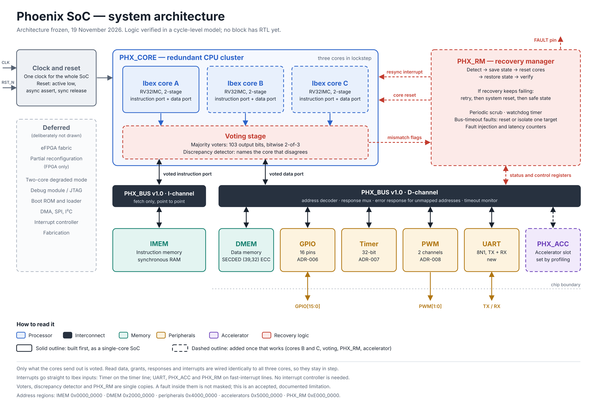

**Idea:** Phoenix SoC is an FPGA-first, ASIC-ready modular embedded computing platform designed to explore computer architecture, digital design, and hardware acceleration using professional engineering practices.

# About this revision

This revision freezes the architecture for RTL. It follows the pre-RTL verification campaign (Python, MATLAB and Simulink models, 13–17 November 2026) and the faculty review of 19 November 2026.

What changed since 13 November 2026:

- Every decision taken during the delegated architecture pass of 13 November is now **Accepted**. The project owner confirmed them on 19 November 2026.
- **ADR-019 (new)** accepts the three protection mechanisms tested in the pre-RTL model: periodic scrub, SECDED on data memory, and a watchdog. They were deferred in the 13 November baseline.
- **ADR-020 (new)** records the two delivery tracks: an FPGA prototype for the results paper, and RTL-to-GDSII in SAED32. Both tracks use the same RTL.
- ADR-010, ADR-012, ADR-016, ADR-017 and ADR-018 carry dated amendments that point to ADR-019 and ADR-020.

ADR-001 to ADR-008 are reproduced as they were written. Where a later decision affects one of them, a dated amendment note is added beneath it and the original text is left unchanged. ADR-002 is superseded.

These ADRs record decisions. The behaviour of the architecture has been checked in a cycle-level model with a stand-in core. No block has RTL yet, and nothing here has been tested on hardware.

**Status labels**

| Label | Meaning |
|---|---|
| Accepted | Decided and confirmed by the project owner. |
| Superseded | Replaced by a later ADR. Kept for the record. |
| OPEN | Named inside an ADR where a point still needs the project owner's decision or missing information. It does not block RTL unless stated. |

**Index**

| ADR | Title | Status |
|---|---|---|
| 001 | PHX_BUS v1.0 | Accepted |
| 002 | CPU Core Selection – PicoRV32 | Superseded by ADR-009 |
| 003 | Memory Organization – Simplified Harvard-Inspired Architecture | Accepted |
| 004 | System Address Map and Address Space Organization | Accepted |
| 005 | Peripheral Selection for Phoenix SoC v0.1 | Accepted, amended by ADR-014 |
| 006 | GPIO Architecture | Accepted |
| 007 | General Purpose Timer (GPT) Architecture | Accepted |
| 008 | PWM Architecture | Accepted |
| 009 | CPU Core Selection – Ibex | Accepted |
| 010 | Implementation Target and Fabrication | Accepted, amended by ADR-020 |
| 011 | PHX_BUS v1.0 Protocol and Topology | Accepted |
| 012 | Memory Subsystem and Address-Map Regions | Accepted, amended by ADR-019; sizes OPEN |
| 013 | Clock, Reset and Interrupt Architecture | Accepted |
| 014 | Peripheral Set Update: UART Added | Accepted |
| 015 | Accelerator Slot (replaces the eFPGA) | Accepted; function OPEN |
| 016 | Redundant CPU Cluster (PHX_CORE) | Accepted |
| 017 | Recovery Manager (PHX_RM) and Recovery Sequence | Accepted, amended by ADR-019 |
| 018 | System Architecture Baseline and Build Order | Accepted, amended by ADR-020 |
| 019 | Protection Mechanisms: Scrub, SECDED and Watchdog | Accepted |
| 020 | Delivery Tracks: FPGA Prototype and SAED32 RTL-to-GDSII | Accepted; board and scan OPEN |

**What is still open after this revision**

| Item | ADR | Blocks |
|---|---|---|
| Application and workload | 015 | PHX_ACC only. RTL of every other block can start. |
| IMEM and DMEM sizes | 012 | Nothing. Sizes are parameters until the SAED32 SRAM macros are listed. |
| FPGA board | 020 | FPGA bring-up (build step 2). |
| Scan insertion in the SAED32 flow | 020 | Nothing before synthesis. |

# ADR-001 — PHX_BUS v1.0

**Status:** Accepted

**Decision:** Phoenix SoC v0.1 will use a custom memory-mapped bus.

**Reason:** Simple, educational, modular, and sufficient for the current scope.

**Future:** Can be replaced or wrapped with Wishbone/APB/AXI-Lite adapters if needed.

> **Amendment, 13 November 2026.** The label is confirmed as PHX_BUS v1.0. This ADR decides that Phoenix has its own bus. What that bus is (its handshake and its topology) is decided in ADR-011.

# ADR-002 — CPU Core Selection – PicoRV32

**Status:** Superseded by ADR-009 (Ibex) on 31 October 2026. The original text is kept below as the record of the earlier decision.

**Problem:** Phoenix SoC requires a RISC-V processor that will act as the central processing unit and communicate with all peripherals through the system bus.

**Alternatives Considered**

**Option 1 – PicoRV32**

- Lightweight and resource efficient
- Mature and well-documented
- Easy to integrate into FPGA designs
- ASIC-friendly and synthesizable

**Option 2 – VexRiscv**

- Higher performance and configurable
- Larger feature set
- More complex integration
- Written in SpinalHDL

**Option 3 – Custom RISC-V CPU**

- Complete architectural control
- Excellent learning opportunity
- Significantly increases project scope and development time

**Decision:** Phoenix SoC v0.1 will use **PicoRV32** as its processor core.

**Reason:** The primary objective of Phoenix is to learn and design the architecture of a modular SoC rather than designing a CPU from scratch.

Having previously worked with PicoRV32 throughout the RTL-to-GDSII flow, it is already a familiar and validated processor core. Reusing it allows the project to focus on bus architecture, peripheral integration, memory mapping, verification, and later ASIC implementation without being delayed by CPU development.

This also provides continuity with previous work while keeping the overall project scope realistic.

**Future Impact:** The CPU is treated as a replaceable IP block. Future versions of Phoenix may evaluate or integrate a custom RISC-V implementation without requiring a complete redesign of the SoC.

# ADR-003 — Memory Organization – Simplified Harvard-Inspired Architecture

**Status:** Accepted

**Problem:** Phoenix SoC requires a memory organization that is simple enough for FPGA implementation while remaining scalable for future SoC features such as additional peripherals, hardware accelerators, and ASIC implementation.

The chosen architecture should also reinforce modern embedded system design concepts without introducing unnecessary complexity during the initial development stages.

**Alternatives Considered**

**Option 1 – Unified Memory (Von Neumann)**

- Single memory for instructions and data.
- Simplest implementation.
- Lower resource utilization.
- Limited scalability for future expansion.

**Option 2 – Full Harvard Architecture**

- Separate instruction and data memories with independent buses.
- Better performance.
- More representative of high-performance processors.
- Considerably increases architectural complexity for the current project scope.

**Option 3 – Simplified Microcontroller-Style Architecture**

- Separate logical regions for Instruction Memory (IMEM), Data Memory (DMEM) and Memory-Mapped Peripherals.
- Lightweight interconnect (PHX_BUS)
- Inspired by modern ARM Cortex-M based microcontrollers while remaining significantly simpler.

**Decision:** Phoenix SoC adopts a **simplified Harvard-inspired memory organization**.

The architecture will contain:

- Instruction Memory (IMEM)
- Data Memory (DMEM)
- Memory-Mapped Peripheral Space

These regions will communicate through the custom **PHX_BUS v1.0**.

The implementation remains intentionally lightweight and FPGA-friendly while preserving architectural concepts commonly used in commercial embedded SoCs.

**Reason:** The primary objective of Phoenix is to learn professional SoC architecture rather than replicate a commercial processor.

A simplified Harvard-inspired organization offers an excellent balance between simplicity and scalability.

It introduces important architectural concepts such as logical memory separation and memory-mapped peripherals while avoiding the complexity of full commercial bus matrices and interconnects.

Additionally, this architecture aligns well with current coursework on ARM-based processors, allowing theoretical concepts learned during the semester to be reinforced through practical implementation in Phoenix.

**Future Impact:** This architecture provides a stable foundation for future versions of Phoenix.

Upcoming additions such as:

- UART
- SPI
- I²C
- DMA
- Hardware Accelerators
- External Memory Interfaces

can be integrated without requiring a redesign of the overall memory organization.

> **Amendment, 13 November 2026.** Ibex has a separate instruction port and data port, so IMEM and DMEM are now reached through two separate PHX_BUS channels (ADR-011). The memory structure itself is in ADR-012. The decision above stands.

# ADR-004 — System Address Map and Address Space Organization

**Status:** Accepted

**Problem:** Phoenix SoC requires a consistent and scalable address map for instruction memory, data memory, peripherals, and future hardware modules.

The address map should remain stable throughout the project's evolution while being intuitive for software development and hardware integration.

**Alternatives Considered**

**Option 1 – Minimal Address Map**

Assign addresses only to currently implemented modules.

**Pros**

- Minimal initial planning.
- No unused address regions.

**Cons**

- Requires changes whenever new peripherals are added.
- Software compatibility becomes difficult to maintain.
- Poor scalability.

**Option 2 – Reserved Address Map (Adopted)**

Reserve address regions for both current and future modules.

The address layout follows the organization commonly used in ARM Cortex-M based microcontrollers while remaining implementation-independent.

**Pros**

- Stable architecture.
- Easier software development.
- Scalable for future peripherals and accelerators.
- Familiar organization for embedded developers.

**Cons**

- Some address regions remain unused during early development.

**Decision:** Phoenix SoC adopts a **32-bit reserved memory map** inspired by modern ARM Cortex-M microcontrollers.

The architecture will reserve dedicated regions for:

- Instruction Memory (IMEM)
- Data Memory (DMEM)
- Memory-Mapped Peripherals
- Hardware Accelerators
- Future Expansion

The memory organization is adopted for architectural clarity and long-term scalability. Phoenix does not aim to replicate the complete ARM memory system or its internal interconnect.

**Reason:** Using a familiar memory organization reduces unnecessary learning overhead and aligns Phoenix with established embedded system design practices.

A reserved address map ensures that future peripherals and hardware accelerators can be added without modifying the overall architecture or breaking software compatibility.

Since Phoenix uses a 32-bit PicoRV32 processor, a 32-bit address space naturally integrates with the CPU without additional address translation logic.

**Future Impact:** Future modules such as:

- UART
- SPI
- I²C
- DMA
- FFT Accelerator
- AI Accelerator
- External Memory Controllers

can be integrated into predefined address regions without affecting existing software or hardware modules.

> **Amendment, 13 November 2026.** The CPU is now Ibex (ADR-009). Ibex is also a 32-bit core, so the reasoning above still holds. The base address of each region is in ADR-012.

# ADR-005 — Peripheral Selection for Phoenix SoC v0.1

**Status:** Accepted. Amended by ADR-014.

**Problem:** Phoenix SoC requires a set of peripherals that provide the essential functionality of an embedded computing platform while keeping the first implementation manageable and allowing future expansion.

**Alternatives Considered**

**Option 1 – Feature-Rich Initial Release**

Include a comprehensive peripheral set in the first version of Phoenix, consisting of GPIO, Timer, PWM, UART, SPI, I²C, Interrupt Controller, DMA, and other supporting modules.

**Pros**

- Rich functionality from the beginning.
- Closer to commercial embedded systems.

**Cons**

- Increased RTL complexity.
- Longer verification and debugging time.
- Higher development effort before achieving a stable first release.

**Option 2 – Minimal Core Peripheral Set (Adopted)**

Implement only the peripherals required to establish a functional embedded platform and defer additional communication and system modules to future revisions.

**Pros**

- Faster development and verification.
- Simpler architecture.
- Reduced implementation complexity.
- Stable foundation for future expansion.

**Cons**

- Limited peripheral functionality in the initial release.

**Decision:** Phoenix SoC v0.1 will include the following peripherals:

- GPIO
- Timer
- PWM

The following peripherals are intentionally deferred to future revisions:

- UART
- SPI
- I²C
- PHX_INTC (Phoenix Interrupt Controller)
- DMA and additional advanced peripherals

**Reason:** The primary objective of Phoenix v0.1 is to establish a stable and functional embedded computing platform rather than maximize the number of peripherals.

GPIO, Timer, and PWM provide sufficient functionality to validate the processor, bus architecture, memory organization, and memory-mapped I/O while keeping the implementation focused and achievable.

UART is deferred because it primarily enhances debugging and external communication rather than enabling the core architecture.

Similarly, a dedicated interrupt controller is postponed until the system contains enough interrupt-generating peripherals to justify the additional architectural complexity.

**Future Impact:** The selected peripheral set provides a stable foundation for future development. Communication peripherals, interrupt management, and advanced system modules can be integrated in later revisions without requiring changes to the overall architecture.

> **Amendment, 13 November 2026.** ADR-014 brings one UART into the peripheral set. PHX_INTC stays deferred, and ADR-013 explains why Ibex's own interrupt inputs are enough. SPI, I²C and DMA stay deferred.

# ADR-006 — GPIO Architecture

**Status:** Accepted

**Problem:** Phoenix SoC v0.1 requires a General-Purpose Input/Output (GPIO) peripheral that provides a flexible and scalable interface between the processor and external digital hardware while maintaining a simple and consistent programming model.

**Alternatives Considered**

**GPIO Width**

- 8 GPIO Pins
- **16 GPIO Pins (Selected)**
- 32 GPIO Pins

**GPIO Direction**

- Output-only GPIO
- Fixed Input/Output GPIO
- **Bidirectional GPIO with Direction Register (Selected)**

**Register Organization**

- Minimal (DATA, DIR)
- **Professional Register Set (Selected)**

**Input/Output Representation**

- Single DATA register
- Mixed DATA behavior
- **Separate Output and Input Registers (Selected)**

**ODR Write Behavior**

- Ignore writes to input pins
- **Always update ODR regardless of pin direction (Selected)**
- Generate an error for writes to input pins

**Decision:** Phoenix SoC v0.1 adopts a **16-bit bidirectional GPIO peripheral** with the following register interface:

| Offset | Register | Description |
|---|---|---|
| 0x00 | **ODR** | Output Data Register |
| 0x04 | **IDR** | Input Data Register |
| 0x08 | **DIR** | Direction Register (0 = Input, 1 = Output) |
| 0x0C | **SET** | Sets selected output bits |
| 0x10 | **CLEAR** | Clears selected output bits |
| 0x14 | **TOGGLE** | Toggles selected output bits |

The **ODR always stores the value written by software**, regardless of the corresponding pin direction. The DIR register alone determines whether the stored value is driven onto the physical GPIO pin.

The **IDR reflects the actual logic level present on the GPIO pins**, independent of the contents of the ODR.

**Reason:** This architecture provides a clean separation between the processor's intended output state and the actual electrical state of the GPIO pins. Each register has a single, well-defined responsibility, improving software clarity and simplifying hardware implementation.

The design also supports easier debugging by allowing software to compare the commanded output state with the observed pin state when required. Maintaining the ODR independently of the direction register enables predictable behavior when a pin transitions between input and output modes.

**Future Impact:** The GPIO register organization establishes the standard peripheral interface philosophy for Phoenix SoC. Future peripherals will follow the same principles of:

- One clearly defined responsibility per register.
- Word-aligned register layout.
- Consistent register naming and access behavior.
- Simple, scalable, and predictable software interfaces.

# ADR-007 — General Purpose Timer (GPT) Architecture

**Status:** Accepted

**Problem:** Phoenix SoC v0.1 requires a general-purpose timer capable of generating accurate time delays and periodic events while remaining simple, reusable, and scalable for future SoC revisions.

**Alternatives Considered**

**Number of Timers**

- **One Timer (Selected)**
- Two Timers
- Multiple Timers

**Counter Width**

- 16-bit
- **32-bit (Selected)**
- 64-bit

**Counting Direction**

- **Up Counter (Selected)**
- Down Counter

**Prescaler**

- No Prescaler
- Fixed Prescaler
- **Programmable Prescaler (Selected)**

**Event Generation**

- Free Running Counter
- **Compare Register (Selected)**

**Timer Operation**

- One-Shot Only
- Periodic Only
- **Configurable One-Shot / Auto-Reload (Selected)**

**Decision:** Phoenix SoC v0.1 shall implement a **single reusable 32-bit General Purpose Timer (GPT)**.

The timer architecture includes:

- **32-bit Up Counter**
- **Programmable Prescaler**
- **Compare Register**
- **Control Register**
- **Status Register**

The timer frequency shall be:

Timer Clock = System Clock / (PRESCALER + 1)

where **PRESCALER = 0** corresponds to divide-by-1.

A **COMPARE** register defines the terminal count value.

The **CONTROL** register shall include:

- Enable bit
- Auto-Reload bit

Operation with **Auto-Reload = 0**: Counter reaches COMPARE → Status flag set → Counter stops.

Operation with **Auto-Reload = 1**: Counter reaches COMPARE → Status flag set → Counter resets to 0 → Counter continues automatically.

**Reason:** This architecture provides a flexible timer capable of supporting both one-shot and periodic operation while requiring only minimal additional hardware.

A programmable prescaler enables operation across a wide range of timing intervals, while the compare-based design simplifies event generation. The configurable auto-reload mechanism makes the timer suitable for common embedded applications such as periodic software timing, LED blinking, PWM generation, and future interrupt-driven operation.

The timer is designed as a reusable IP block, allowing additional timer instances to be added in future Phoenix SoC revisions without architectural modifications.

**Future Impact:** The timer architecture establishes the standard timing infrastructure for Phoenix SoC and serves as the foundation for future peripherals and software services, including:

- PWM generation
- Operating system tick generation
- Periodic task scheduling
- Timeout management
- Interrupt-driven timing
- Multiple timer instances through IP reuse

> **Amendment, 13 November 2026.** The timer's status flag drives Ibex's timer interrupt input (ADR-013). The bit that enables this interrupt belongs to the timer register specification, which is still to be written.

# ADR-008 — PWM Architecture

**Status:** Accepted

**Problem:** Phoenix SoC v0.1 requires a Pulse Width Modulation (PWM) peripheral capable of generating configurable digital waveforms for applications such as motor control, LED dimming, and other embedded control systems. The design should remain modular, reusable, and scalable while maintaining a simple programming interface.

**Alternatives Considered**

**PWM Architecture**

- Timer-based PWM
- **Dedicated PWM Peripheral (Selected)**

**Number of Channels**

- Single Channel
- **Two Channels (Selected)**
- Four Channels

**Counter Width**

- **16-bit (Selected)**
- 32-bit
- 64-bit

**Waveform Generation**

- **Comparator-Based PWM (Selected)**
- FSM-Based PWM

**Frequency Control**

- Fixed Period
- **Programmable Period Register (Selected)**

**Clock Division**

- No Prescaler
- Fixed Prescaler
- **Programmable Prescaler (Selected)**

**Decision:** Phoenix SoC v0.1 shall implement a **dedicated PWM peripheral** independent of the General Purpose Timer.

The PWM peripheral shall include:

- Two independent PWM output channels
- 16-bit up-counter
- Programmable prescaler
- Programmable period register
- Independent duty cycle registers for each channel
- Comparator-based waveform generation

The PWM frequency shall be determined by the programmable prescaler and the programmable period register, while the duty cycle of each channel shall be independently controlled through its corresponding duty register.

Each PWM output shall be generated using comparator logic:

```
if (Counter < Duty)
    PWM_Output = HIGH;
else
    PWM_Output = LOW;
```

**Reason:** A dedicated PWM peripheral keeps waveform generation independent of the General Purpose Timer, allowing both peripherals to operate simultaneously without resource conflicts.

Using a comparator-based architecture minimizes hardware complexity while providing deterministic waveform generation.

The combination of a programmable prescaler and programmable period register provides a wide frequency range, while independent duty registers allow each PWM channel to generate different output duty cycles using the same timing base.

This architecture provides sufficient flexibility for embedded applications while remaining compact and easily reusable.

**Future Impact:** The PWM architecture establishes a reusable waveform generation IP for Phoenix SoC.

Future revisions may expand the peripheral by adding:

- Additional PWM channels
- Complementary PWM outputs
- Dead-time insertion
- Output polarity control
- Fault protection
- Synchronized multi-channel operation

without requiring changes to the overall architecture.

# ADR-009 — CPU Core Selection – Ibex

**Status:** Accepted (confirmed by the project owner on 31 October 2026; rationale confirmed 19 November 2026). Supersedes ADR-002.

**Problem:** ADR-002 chose PicoRV32 before the October CPU evaluation and before the self-recovery research direction existed. The CPU now has to do four things PicoRV32 was never chosen for:

- Fit a memory system with separate instruction and data memories (ADR-003).
- Run as three identical copies in lockstep (ADR-016).
- Take standard RISC-V interrupts, because recovery uses one (ADR-017).
- Be defensible next to the two base papers, which both use CV32E40P.

**Alternatives Considered**

**Option 1 – PicoRV32 (the earlier choice)**

- Smallest of the three, and already taken through RTL-to-GDSII in SAED32 by the team.
- One shared memory port. A flag marks which accesses are instruction fetches, so the instruction and data paths are not physically separate.
- Its interrupt handling is its own scheme and does not follow the RISC-V privileged specification.
- Not pipelined: several clock cycles per instruction.

**Option 2 – CV32E40P**

- The core used in both base papers (Arnold and the self-healing architecture).
- Four-stage pipeline, optional floating-point unit and custom extensions.
- The largest of the three. That cost is paid three times in a triplicated cluster.

**Option 3 – Ibex (Selected)**

- Two-stage RV32IMC core with a separate instruction port and data port.
- Standard machine-mode interrupts, including 15 fast interrupt inputs.
- Documented integration guide, and a named, supported "small" configuration.
- Published precedent for exactly this use: the ODRG paper triplicates Ibex cores with voters and a resynchronisation routine, and the Trikarenos chip runs three lockstepped Ibex cores in 28 nm.
- Written in SystemVerilog, so it needs a simulator such as VCS (available through C2S).

**Decision:** Phoenix uses **Ibex** as its processor core, in the "small" configuration:

| Item | Setting |
|---|---|
| Instruction set | RV32IMC |
| Pipeline | Two stages (no writeback stage) |
| Multiplier | 3-cycle (RV32MFast) |
| Physical memory protection | Off |
| Instruction cache | Off |
| SecureIbex (built-in lockstep and integrity bits) | Off |
| Register file | Flip-flop version for SAED32, FPGA version on FPGA |
| Debug request, NMI, software and external interrupt inputs | Tied off |

The core is used unmodified, from one pinned commit of the lowRISC repository.

**Reason:** Ibex is the smallest core that meets all four requirements. Its two ports make the Harvard-inspired memory of ADR-003 a physical fact. Its standard interrupts give the recovery manager a clean way to ask software to save state. Its "small" configuration is one that lowRISC lists as a focus of verification, so Phoenix builds on a tested core.

Ibex's own lockstep option (SecureIbex) is not used. It adds one shadow core and raises an alert when the two disagree. Two cores can show that something is wrong, but not which one is wrong, so they cannot outvote a fault. Phoenix needs three.

Choosing a different core from the papers is a point in Phoenix's favour, if it is presented that way. The self-healing paper states that its approach is not tied to one RISC-V implementation. Building it with Ibex tests that statement.

**Future Impact:** The CPU stays a replaceable block. CV32E40P uses the same request / grant / response-valid handshake family as Ibex, so PHX_BUS (ADR-011) could host it later for a direct comparison with the papers.

# ADR-010 — Implementation Target and Fabrication

**Status:** Accepted (project owner, 4–5 November 2026).

**Problem:** Phoenix aims at a full RTL-to-GDSII result. A GF180 shuttle in January was considered as a route to real silicon. The team needs one agreed target so that memory, reset and test decisions are made for the right technology.

**Alternatives Considered**

**Option 1 – GF180MCU shuttle tapeout**

- Real silicon.
- The slot available to the team is about 160 × 170 µm, roughly 0.027 mm². At 180 nm that holds a few thousand gates. One Ibex core alone is several times larger, before memory and before triplication.
- Also needs a boot path, a pad ring and post-silicon observability, none of which exist yet.

**Option 2 – SAED32 educational library, full flow, no fabrication (Selected)**

- The team has already taken PicoRV32 from RTL to GDSII in SAED32 with Design Compiler, ICC2 and PrimeTime.
- SAED32 cannot be fabricated. It is a teaching library with no foundry behind it, so its numbers are indicative.

**Option 3 – FPGA only**

- Fastest route to a demonstration.
- Produces no ASIC timing, area or layout evidence.

**Decision:**

- Phoenix is validated on FPGA first.
- The ASIC implementation is a full RTL-to-GDSII flow in **SAED32** with the Synopsys tools.
- **Fabrication is deferred.** No tapeout is planned for this project phase.
- The physical flow is hierarchical: one Ibex core is implemented as a block and placed three times. Memories are SRAM macros, not flip-flops.

**Reason:** The slot is far too small for the design; that is the reason for deferring fabrication, and it is the one to give in the report. SAED32 lets the team run every stage of the flow on tools and scripts it already knows, which removes most of the schedule risk from the back end.

Results must be described accurately: "RTL-to-GDSII in the SAED32 educational library, fabrication deferred". Checks run inside ICC2 are "in-design DRC and connectivity checks", not foundry signoff.

**Future Impact:** A later tapeout would need a larger slot, a boot ROM or loader, a pad ring, and a decision on scan.

> **Amendment, 19 November 2026.** The ASIC track goes ahead. The team will use the college's SAED32 library files and Synopsys tools to complete RTL-to-GDSII for Phoenix, in parallel with the FPGA prototype. Fabrication stays deferred. How the two tracks share one RTL, and what each must produce, is decided in ADR-020. Still to be checked before the flow starts: which SRAM macros the SAED32 kit contains.

# ADR-011 — PHX_BUS v1.0 Protocol and Topology

**Status:** Accepted (decided 13 November 2026, confirmed by the project owner 19 November 2026). The signal-level specification is the next document to write.

**Problem:** ADR-001 decided that Phoenix has its own bus, but not what the bus is. Ibex adds a constraint that did not exist when ADR-001 was written: the core has two ports, one for instruction fetch and one for data, and each uses a request / grant / response-valid handshake. The bus must also be able to say "this address does not exist", and it must never wait forever for a target that has stopped answering.

**Alternatives Considered**

**Which handshake**

| Option | Best-case throughput | Logic needed between Ibex and the bus | Assessment |
|---|---|---|---|
| APB | One transfer every two cycles | Bridge | Good for slow peripherals. Too slow for memory and unsuitable for instruction fetch. |
| AHB-Lite | One transfer per cycle | Bridge, plus transfer-type and size signalling | Fast, but more protocol than Phoenix needs. |
| AXI4-Lite | One transfer per cycle | Bridge to five separate channels | Built for larger systems. The most area and the most verification work. |
| Wishbone | One transfer per one or two cycles, depending on how the acknowledge is produced | Small adapter | Reasonable, but offers nothing over the native handshake. |
| **Ibex-native request / grant / response-valid (Selected)** | One transfer per cycle | None | Fastest and smallest for this CPU. |

**Which topology**

- One shared bus, with an arbiter choosing between fetch and data access each cycle.
- **Two channels, one per Ibex port (Selected).**
- A full crossbar with arbitration, as in Arnold. Arnold needs one because several masters share its memory (core, I/O DMA, JTAG, eFPGA). Phoenix has one.

**Decision:**

1. **Handshake.** PHX_BUS v1.0 has an address phase (request and grant) and a response phase (response-valid, with read data and an error flag). This is the same handshake family as Ibex's memory interface, so the CPU cluster connects to the bus with no bridge.
2. **Two channels.**
   - The **I-channel** runs point to point from the voted instruction port to IMEM. It is read-only.
   - The **D-channel** runs from the voted data port through an address decoder and a response multiplexer to DMEM, the peripherals, the accelerator region and the PHX_RM registers.
3. **One master per channel.** There is no arbiter.
4. **Widths.** 32-bit address, 32-bit data, four byte enables on the D-channel, one clock.
5. **Error response.** An access to an unmapped address is answered by a default target with the error flag set. Ibex then raises an access-fault exception. An instruction fetch outside IMEM is answered the same way.
6. **Wait states.** A target may delay its grant or its response. Memories and the baseline peripherals respond one cycle after the grant. Responses come back in the order the requests were granted.
7. **Timeout monitor (D-channel).** If a granted request receives no response within a programmable number of cycles, the interconnect completes the transfer itself with an error response and reports the target to PHX_RM. One stuck peripheral therefore cannot freeze the processor.
8. **Decoding.** The decoder looks only at the top four address bits (regions in ADR-012).

Left to the PHX_BUS v1.0 specification: signal names, cycle-by-cycle timing diagrams, reset values, the exact rule that keeps responses in order, and the timeout register.

**Reason:**

- **Speed.** With a synchronous RAM that answers one cycle after the grant, Ibex can issue a new fetch every cycle, and a load or store costs the one extra cycle that Ibex always needs. A bridge to APB, AHB or AXI would add logic to this path and usually a cycle. Fetch and data access also run at the same time, because they never share wires and never wait for an arbiter.
- **Simplicity.** Two phases and a handful of signals, in keeping with ADR-001.
- **Agreement with the base paper.** The self-healing architecture also gives its shared memory a dedicated instruction port and a dedicated data port, and votes before the memory.
- **Replaceability.** CV32E40P's interface belongs to the same family, so a later CPU swap does not change the bus.

One timing caution for the specification: Ibex has a combinational path from its data response-valid input to its data request output (lowRISC/ibex issue 2258). Targets must therefore drive response-valid and read data from registers.

**Future Impact:** Reused IP that speaks APB, Wishbone or AXI4-Lite can be attached through a small adapter, as ADR-001 foresaw. A second master on the D-channel (a DMA engine, or an accelerator with its own memory port) would need an arbiter; that is deferred.

# ADR-012 — Memory Subsystem and Address-Map Regions

**Status:** Accepted (decided 13 November 2026, confirmed 19 November 2026). Amended by ADR-019. Memory sizes are OPEN.

**Problem:** ADR-003 and ADR-004 fixed the memory concept and the idea of reserved regions, but assigned no base addresses and did not say how the memories are built or where the CPU starts executing.

**Alternatives Considered**

**Memory structure**

- One RAM shared by fetch and data. Needs an arbiter and halves the throughput.
- **Separate IMEM and DMEM, each a single-port RAM (Selected).**
- A dual-port IMEM so that the data side can also read it. Costs macro area and is not needed, because constants can be placed in DMEM.

**Program loading**

- **Both memories are preloaded: by the testbench in simulation, by the bitstream on FPGA (Selected for this phase).**
- A boot ROM with a UART or SPI loader. Needed for a fabricated chip; deferred together with fabrication.

**Protection of memory contents**

- **None in the baseline (Selected).**
- Single-error-correcting, double-error-detecting code (SECDED), as in the self-healing paper. Deferred.

**Decision:**

- **IMEM** is a synchronous single-port RAM read through the I-channel. It holds the vector table and the program code.
- **DMEM** is a synchronous single-port RAM with byte enables on the D-channel. It holds constants, initialised and zero-initialised data, the stack, and the area where the cores save their state during recovery.
- Both sit behind one wrapper module with a fixed interface. Inside the wrapper is an SRAM macro in SAED32, a block RAM on FPGA, or a behavioural array in simulation.
- Address regions:

| Region | Base address | Contents |
|---|---|---|
| Code | 0x0000_0000 | IMEM |
| Data | 0x2000_0000 | DMEM |
| Peripherals | 0x4000_0000 | GPIO, Timer, PWM, UART |
| Accelerators | 0x5000_0000 | PHX_ACC slots |
| System | 0xE000_0000 | PHX_RM registers |
| Everything else | — | Reserved. Answered with an error response. |

- **Start of execution.** Ibex's boot address input is tied to 0x0000_0000. Ibex places its vector table in the first 0x80 bytes and fetches its first instruction from 0x0000_0080.

Left to the specifications: the size of IMEM and DMEM, and the base address of each peripheral inside the peripheral region.

**Reason:** The layout follows the Cortex-M organisation that ADR-004 asked for: code at the bottom, RAM at 0x2000_0000, peripherals at 0x4000_0000 and system control at 0xE000_0000. The regions differ in their top four address bits, so the decoder compares four bits and stays shallow.

The memories are not triplicated. As in the self-healing paper, the three cores share one memory, and the voters stop a faulty core from writing to it. Upsets in the stored bits themselves are outside the baseline fault model (ADR-017).

**Future Impact:** SECDED can be added inside the memory wrapper without touching the bus or the cores. A boot ROM region and external memory can take reserved regions.

**Open item:** memory sizes depend on the SRAM macros in the SAED32 kit and on the chosen application. Until both are known, size is a parameter.

> **Amendment, 19 November 2026.** Memory protection is no longer "none". ADR-019 adds SECDED (39,32) on DMEM inside the memory wrapper, as this ADR's Future Impact anticipated. The bus and the cores are unchanged. IMEM stays unprotected in this phase.

# ADR-013 — Clock, Reset and Interrupt Architecture

**Status:** Accepted (decided 13 November 2026, confirmed 19 November 2026).

**Problem:** Reset was listed as an open contract in the Engineering Bible. ADR-005 deferred the interrupt controller, yet recovery needs an interrupt. Lockstep adds a rule of its own: the three cores must see identical inputs on every clock cycle, or they drift apart with no fault present.

**Alternatives Considered**

**Clock**

- **One clock for the whole SoC (Selected).**
- Separate clock domains for peripherals or accelerators, as in Arnold. Adds clock-domain crossings for no benefit at this scale.

**Reset**

- Fully synchronous reset.
- **Active-low reset, asserted asynchronously and released synchronously (Selected).**

**Interrupts**

- A Phoenix interrupt controller (PHX_INTC).
- **Ibex's own interrupt inputs (Selected).**

**Decision:**

**Clock.** One clock drives every block.

**Reset.** Reset is active low. It is asserted asynchronously and released through a two-flop synchroniser, one per reset domain:

| Reset | Asserted by | Resets |
|---|---|---|
| Power-on reset | External pin | Everything, including PHX_RM's fault history |
| System reset | Power-on reset, or PHX_RM escalation | Everything except PHX_RM's fault history |
| Core reset | System reset, or PHX_RM during recovery | The CPU cluster only. Memories, peripherals and PHX_RM keep running. |
| Target reset (one per D-channel peripheral) | System reset, or a PHX_RM control bit | That one peripheral |

**Lockstep rule: synchronise once, then fan out.** Reset release, external pins (GPIO inputs, UART receive) and interrupt lines are each synchronised a single time. The same registered signal then goes to all three cores. All three cores also receive the same hart ID and the same boot address.

**Interrupts.** There is no interrupt controller. Sources connect directly to Ibex:

| Source | Ibex input |
|---|---|
| PHX_RM resynchronisation request | Fast interrupt 0 (highest priority of the maskable interrupts) |
| Timer | Timer interrupt |
| UART | A fast interrupt line |
| PHX_ACC "done" | A fast interrupt line |
| NMI, software and external interrupt inputs | Tied off |

Interrupt lines are level-sensitive: a source holds its line until software clears the cause. GPIO and PWM have no interrupt output in ADR-006 and ADR-008, and none is added here. Line numbers for UART and PHX_ACC are an integration-specification item.

**Reason:**

- **Reset.** Ibex's reset input is active low and asynchronous, so Phoenix adopts the same convention and needs no adaptation. Asynchronous assertion works even if the clock is not running. Synchronous release keeps flip-flops from leaving reset on different clock edges.
- **Interrupts.** Ibex provides 15 fast interrupt inputs and a per-source enable register. Phoenix has four sources. A separate controller would be extra logic doing what the core already does.
- **Why recovery uses a maskable interrupt and not the NMI.** An NMI can arrive while the program is already inside a trap handler. Ibex keeps the interrupted handler's return state in internal registers that software cannot read, so that state could not be saved and would be lost when the cores are reset. A maskable interrupt is only taken when software has interrupts enabled. Everything needed to resume is then in ordinary registers. The cost is that recovery waits until interrupts are enabled; PHX_RM applies a timeout to that wait.

**Future Impact:** PHX_INTC is only needed if Phoenix ever has more than 15 interrupt sources. The NMI input stays free. A second clock domain would need its own synchronisers and a review of the lockstep rule.

# ADR-014 — Peripheral Set Update: UART Added

**Status:** Accepted (decided 13 November 2026, confirmed by the project owner 19 November 2026). This reverses one part of ADR-005.

**Problem:** ADR-005 deferred the UART because it "primarily enhances debugging". Three things have changed since. The recovery research needs a way to report fault and recovery events off the chip. The FPGA demonstration needs a way to print results. Phoenix has no debug module.

**Alternatives Considered**

- Keep the UART deferred and observe through GPIO pins and waveforms. Sufficient in simulation, weak on a board.
- Add a JTAG debug module. Much larger, and unnecessary for the experiments planned.
- **Add one minimal UART (Selected).**

**Decision:** The peripheral set is:

| Peripheral | Defined in |
|---|---|
| GPIO, 16 pins | ADR-006 |
| Timer, 32-bit | ADR-007 |
| PWM, 2 channels | ADR-008 |
| UART: 8 data bits, no parity, 1 stop bit, programmable baud divider, transmit and receive, one interrupt line | This ADR; register map in the UART specification |

SPI, I²C, DMA and PHX_INTC stay deferred.

**Reason:** The self-healing paper reports every detection and recovery over a UART to an external monitor, and Phoenix's experiments need the same channel. A UART of this kind is small, and it removes the need for a debug module in this phase.

**Future Impact:** A boot loader over UART becomes possible when fabrication is revisited.

# ADR-015 — Accelerator Slot (replaces the eFPGA)

**Status:** Accepted (proposed by the project owner on 1 November 2026, confirmed 19 November 2026). The accelerator's function is OPEN until the application is chosen. This does not block RTL of any other block; PHX_ACC is build step 5.

**Problem:** Arnold's central feature is an embedded FPGA, a hard macro licensed from QuickLogic. A standard-cell RTL-to-GDSII flow cannot produce one. Phoenix still wants the benefit Arnold demonstrates: moving the hottest computation out of software and into hardware beside the CPU.

**Alternatives Considered**

- An open-source eFPGA generator (OpenFPGA, FABulous). A project of its own.
- A programmable region that exists only on the FPGA prototype. Leaves nothing in the ASIC.
- Custom instructions inside the CPU. Ibex has no coprocessor port, so this means modifying a verified core, three times over.
- **Fixed-function accelerators chosen by profiling (Selected).**

**Decision:**

- **PHX_ACC** is a memory-mapped target on the D-channel, in the accelerator region. It has control, status and data registers, and a "done" interrupt.
- **Its function is chosen by measurement.** The application first runs in software on Ibex. It is profiled, and the operation that takes the most time is moved into hardware.
- Phoenix starts with **one** accelerator. The region has room for more.
- PHX_ACC is a bus target only. It has no memory port of its own and there is no DMA. The CPU moves the data.

**Reason:** This keeps the part of Arnold that a standard-cell flow can build. Arnold itself places two fixed multiply-accumulate units beside its fabric, and its use cases (CRC, a binary neural network, a wavelet transform) show the kind of operation that pays off. Profiling first also gives the baseline that any speed-up claim needs: software only against software plus accelerator, on the same core and the same process.

The trade must be stated plainly: a fixed accelerator cannot be reprogrammed after fabrication, which was the point of Arnold's fabric.

**Future Impact:** If profiling shows that copying data dominates, PHX_ACC can gain a memory port, which then needs an arbiter on the D-channel. The voters do not protect the accelerator. Its faults are covered by the bus timeout and by a known-answer test (ADR-017).

**Open item:** the application and workload. Nothing can be profiled until one is chosen.

# ADR-016 — Redundant CPU Cluster (PHX_CORE)

**Status:** Accepted. The voter position and the single voting stage were confirmed by the project owner on 13 November 2026; the rest was confirmed on 19 November 2026.

**Problem:** Phoenix must keep running correctly when a transient fault flips a bit in the state of one core, and it must do so in an ASIC, where there is no configuration memory to rewrite.

**Alternatives Considered**

- **One core, reset on error.** Nothing detects the error, and a reset loses the program state.
- **Two cores in lockstep.** Detects a mismatch but cannot tell which core is wrong, so the only safe response is to stop.
- **Three cores, voting where the cluster meets the bus (Selected).**
- **Three cores, each with its own bus, voting at every target.** Triplicates the bus and every target's interface for little gain.
- **Triplicating every flip-flop inside one core.** Highest coverage, but needs a modified core or a special synthesis flow, and loses the clean block boundary.

**Decision:**

- PHX_CORE contains three identical, unmodified Ibex cores. They share one clock and receive the same inputs on the same cycle.
- A **majority voter** sits on every signal the cores send to the bus: instruction request and address, data request, address, write enable, byte enables and write data. That is 103 bits. Each bit is voted separately: Out = A·B + B·C + A·C.
- Signals coming **into** the cores are not voted. They are fanned out to all three.
- A **discrepancy detector** compares the three sets of outputs every cycle. It raises one flag per core, and a "no majority" flag if all three differ. The flags go to PHX_RM.
- To the rest of the SoC, the cluster is one CPU with one instruction port and one data port. A build parameter selects one core (voters bypassed) or three. Nothing outside PHX_CORE changes between the two.
- The voters and the detector are single copies.

**Reason:** Voting at the cluster boundary is what the self-healing paper does, and it keeps redundancy inside one block. The bus, the memories and the peripherals never know there are three cores. That is also what lets Phoenix be built and verified first with a single core.

The voter adds a few gate delays to the path from the cores to the bus and no clock cycles. If that path limits the clock frequency, a register can be placed after the voter at the cost of one cycle.

The area cost is mostly the two extra cores. For scale, the ODRG paper reports that its voting and control unit adds less than 11% of the area of one Ibex core.

**Limits, stated as part of the decision:**

- A fault in the voters or the detector is not masked.
- Faults that hit all three cores the same way (clock, reset, memory contents, a design bug) are not masked.
- An upset in a register the program is not currently using stays hidden until it reaches an output. The self-healing paper notes the same.

**Future Impact:** The voters can be triplicated later. On FPGA, each core is already a clean boundary for partial reconfiguration, should that be explored.

> **Amendment, 19 November 2026.** The 103 voted bits are the two memory ports. Ibex has other outputs as well (for example its sleep, alert and crash-dump outputs). The PHX_CORE specification must list every Ibex output and state, for each one, whether it is voted, compared by the detector, taken from one core, or left unconnected. The pre-RTL model voted the 103 memory-port bits only, and found that the hidden faults this leaves are cleared by the periodic scrub (ADR-019).

# ADR-017 — Recovery Manager (PHX_RM) and Recovery Sequence

**Status:** Accepted (decided 13 November 2026, confirmed 19 November 2026). Amended by ADR-019.

**Problem:** The voter hides a faulty core. It does not repair it, and a second fault would then leave no majority. The self-healing paper repairs the core by rewriting FPGA configuration memory and then resynchronises it through an interrupt routine. An ASIC has no configuration memory; the fault sits in flip-flops. Phoenix needs a repair that works there, and it needs a defined response when repair fails. Some faults are also invisible to the voters, such as a peripheral that stops answering.

**Fault model**

| | Fault | How it shows |
|---|---|---|
| F1 | A transient upset in the internal state of one core | That core's outputs differ from the other two |
| F2 | A D-channel target that stops responding | A granted request gets no response |

Not handled: upsets in memory contents; faults in the voters, the detector, the bus or PHX_RM; faults common to all three cores; software bugs. Permanent faults are detected and end in the safe state.

**Alternatives Considered (how to bring a faulty core back)**

- **Reset only the faulty core.** It restarts from the boot address while the others are in the middle of the program, and never lines up with them again.
- **Reload in place.** Interrupt all three, save the state, reload it, with no reset. Used by ODRG and by the self-healing paper. The faulty core's hidden pipeline and control state may still differ afterwards.
- **Save, reset all three, restore (Selected).** Used by the Hybrid Modular Redundancy work and by ARM's triple-core lockstep design.
- **Full system reset on every fault.** Simple, but all program state is lost every time.

**Decision — sequence for F1**

1. **Monitor.** PHX_RM watches the detector flags.
2. **Detect.** A flag is raised for one core.
3. **Classify.** One core disagreeing is recoverable. More than one, or no majority, is not; go to escalation.
4. **Isolate.** The voter is already outvoting the faulty core. PHX_RM ignores that core's flag until recovery ends and keeps comparing the two healthy cores.
5. **Save.** PHX_RM raises the resynchronisation interrupt. The handler pushes the 31 integer registers and the machine-mode registers it needs onto the stack, through the voted data port, so only the majority's values reach memory. It then writes the stack pointer to a PHX_RM register. That write means "state saved".
6. **Reset.** PHX_RM waits for the bus to be idle and asserts core reset to all three cores together.
7. **Restore.** The cores leave reset on the same cycle, in the same state. The start-up code reads the PHX_RM register. A saved stack pointer means "resume": reload the registers and return to the interrupted program. Zero means a normal cold start.
8. **Verify.** Software clears the register. PHX_RM then watches N cycles for any mismatch. If there is none, the recovery is counted as successful and PHX_RM returns to step 1.

**Escalation**

- A failed or timed-out attempt is retried, up to M attempts.
- After M failures: one **system reset**. Program state is lost and the application restarts.
- If the fault returns after that: **safe state**. The cluster is held in reset, the FAULT pin is asserted, and peripheral outputs are forced to their reset values (GPIO pins become inputs, PWM outputs go low) until a power-on reset.
- PHX_RM's fault history survives a system reset and is cleared only by a power-on reset. This is what stops a permanent fault from causing an endless loop of resets.
- N and M are programmable. They start at the paper's values, N = 50 cycles and M = 3, and are tuned by experiment.

**Decision — sequence for F2**

1. The D-channel timeout monitor ends the stuck transfer with an error response and tells PHX_RM which target it was.
2. Ibex takes an access-fault exception.
3. The trap handler asks PHX_RM to pulse that target's reset, sets the target up again, and repeats the access as a known-good check.
4. If the access fails again, the handler sets the target's isolate bit. From then on the decoder answers every access to that target with an immediate error. The application continues without the target or requests the safe state.

**Decision — evidence and fault injection**

- PHX_RM contains a free-running cycle counter and latches its value at detection, at "state saved", at reset release and at "verified". Detection latency and service-restoration latency are therefore read as two separate numbers.
- PHX_RM counts detections, successful recoveries and escalations.
- **Injection in simulation:** force a flip-flop inside one core from the testbench. No hardware is needed.
- **Injection in hardware:** a PHX_RM test register can pulse the reset of one core alone, so that core loses its state while the others carry on, or invert chosen output bits of one core ahead of the voter. Both are enabled only by a test-enable input.
- PHX_RM's registers are in the system region of the D-channel. PHX_RM is a single copy.

**Reason:** After a reset of all three cores, lockstep is guaranteed by construction: three identical cores leave reset on the same clock edge with identical state. Reloading in place has to trust that a core with corrupted hidden state falls back into step by itself. The selected sequence also needs no change inside Ibex, because it uses only the reset and interrupt pins.

It is not the same as an ordinary reset. The fault is detected and located; the program's state is saved before the reset and restored after it, so the application continues where it stopped; and the result is checked before the fault is closed. Peripherals such as PWM keep running throughout.

For scale, published figures for the same kind of routine: about 700 cycles for Ibex in ODRG, 363 cycles in the Hybrid Modular Redundancy work, and 183 cycles for the interrupt routine in the self-healing paper. Phoenix's own figure has to be measured.

**Future Impact:** A degraded two-core mode (detect only) between "retry" and "safe state". A watchdog for hangs that affect all three cores equally. Triplicated state inside PHX_RM. On FPGA, partial reconfiguration as an extra repair step before step 6.

> **Amendment, 19 November 2026.** Three points are settled.
>
> - **Safe-state pin behaviour is accepted as written:** GPIO pins become inputs and PWM outputs go low. If the chosen application needs different safe values, that is a change to this ADR.
> - **N = 50 and M = 3 are the baseline values** for RTL. They stay programmable. The pre-RTL model used them and recovered every single-core fault in 10,000 runs.
> - **PHX_RM gains the periodic scrub and the watchdog** of ADR-019. The scrub starts the same save, reset, restore and verify sequence as a detected mismatch. The watchdog goes straight to escalation (system reset, then safe state). It covers hangs that affect all three cores equally, which this ADR listed as future work.
>
> The pre-RTL model measured a median recovery of 136 cycles for its stand-in core. The Ibex figure must still be measured in RTL.

# ADR-018 — System Architecture Baseline and Build Order

**Status:** Accepted (decided 13 November 2026, confirmed 19 November 2026). Amended by ADR-020. Replaces the architecture figure in the October evaluation slides.

**Problem:** The October architecture figure shows a core that was "not chosen yet", an eFPGA, repair by partial reconfiguration and a triplicated hypervisor. All four have changed. The block specifications need one current reference.

**Decision:** The Phoenix architecture is the one in the figure below, made of the blocks in the table.



| Block | Role | Decided in | Build step |
|---|---|---|---|
| PHX_CORE | One or three Ibex cores, voters, discrepancy detector | ADR-009, ADR-016 | 1 (one core), 4 (three cores) |
| PHX_BUS v1.0 | I-channel and D-channel | ADR-001, ADR-011 | 1 |
| IMEM, DMEM | Instruction and data memory; SECDED on DMEM | ADR-003, ADR-012, ADR-019 | 1 (SECDED in 4) |
| Clock and reset | One clock, four reset domains | ADR-013 | 1 |
| GPIO, Timer, PWM, UART | Peripherals | ADR-005 to ADR-008, ADR-014 | 1 |
| PHX_RM | Recovery manager, with scrub and watchdog | ADR-017, ADR-019 | 3 (F2), 4 (F1) |
| PHX_ACC | Accelerator slot | ADR-015 | 5 |

**Build order.** These are steps in building one architecture, not product versions.

1. **Single-core SoC in simulation.** One Ibex, both bus channels, both memories, the four peripherals, clock and reset. Done when a C program runs in VCS, drives GPIO and PWM, uses the timer interrupt and prints over the UART.
2. **FPGA bring-up and first synthesis** of step 1 in SAED32.
3. **Bus timeout and PHX_RM, F2 path.** Done when a target forced to stop responding is detected, reset and checked, and when a target that stays broken is isolated.
4. **Three cores, voters, detector and PHX_RM, F1 path.** Done when a fault-injection campaign in simulation shows detection, recovery and the escalation path, with measured latencies.
5. **Application, profiling and PHX_ACC.**
6. **RTL-to-GDSII in SAED32**, hierarchical.

**What Phoenix takes from each base paper**

| Paper | Kept | Not carried over |
|---|---|---|
| Arnold | Hardware beside the microcontroller for the hottest operation; fixed arithmetic units; interrupt on completion; memory-mapped control | The eFPGA fabric; the I/O DMA; multiple clock and power domains; body biasing |
| Self-healing architecture | Three lockstepped cores; voters on the bus outputs; discrepancy detection; a hardware recovery manager; resynchronisation through an interrupt routine; the N-cycle check and M-attempt limit; shared memory with separate instruction and data ports; SECDED on data memory (ADR-019) | Repair by partial reconfiguration (an ASIC has no configuration memory); the triplicated hypervisor (single copy in Phoenix) |

**Deferred:** eFPGA fabric; partial reconfiguration (FPGA only); ECC on IMEM; degraded two-core mode; debug module; boot ROM and loader; DMA; SPI; I²C; PHX_INTC; fabrication.

**Reason:** Every block either exists in the baseline ADRs or is needed by one of the two fault classes. Nothing is included for completeness alone. The order builds each layer on one that already works, so a failure always points at the newest block.

**Future Impact:** The Engineering Bible's status snapshot and the evaluation slides still describe the October state and should be updated from this ADR.

> **Amendment, 19 November 2026.** The architecture is frozen for RTL. The pre-RTL model checked the logic of every block in this table except PHX_ACC. The UART, the Ibex rationale and the safe-state pin behaviour are confirmed. Memory ECC and the watchdog move out of the deferred list (ADR-019). The build order above now feeds two delivery tracks that share one RTL; ADR-020 gives the order of work for each. Still open: the application (PHX_ACC only) and the memory sizes (parameters until the SAED32 macros are known).

# ADR-019 — Protection Mechanisms: Scrub, SECDED and Watchdog

**Status:** Accepted (project owner, 19 November 2026, after the faculty review of the pre-RTL verification report).

**Problem:** The pre-RTL campaign (68,400 fault-injection runs on a cycle-level model, 13–17 November 2026) showed that the 13 November baseline left three gaps:

| Gap | Evidence in the baseline model |
|---|---|
| Hidden faults | 21.9% of single-core flips stayed inside a core to the end of the run. The voters cannot see a wrong value that never reaches an output, and a second fault in another core could then outvote the healthy one. |
| Memory upsets | 70.1% of single-bit flips in DMEM produced a wrong result. All three cores read the same memory, so they agree on the wrong value and the voters cannot help. |
| Long hangs | Detection latency reached 1,869 cycles. A fault that makes all three cores loop together is invisible to the voters. |

**Alternatives Considered**

**Hidden faults**

- Accept them and document the risk.
- Vote or compare internal core state every cycle. Needs access inside Ibex, which ADR-016 rules out.
- **Periodic scrub: run the recovery sequence on a timer, even without a mismatch (Selected).**

**Memory upsets**

- Triplicate DMEM and vote on reads. Three times the memory area.
- Parity. Detects one bad bit but cannot correct it.
- **SECDED (39,32) code inside the memory wrapper (Selected).**

**Hangs**

- Rely on the bus timeout monitor. It only catches a target that stops answering, not a program that loops.
- **Watchdog timer in PHX_RM (Selected).**

**Decision**

1. **Periodic scrub.** PHX_RM starts the save, reset, restore and verify sequence of ADR-017 every T_scrub cycles, whether or not a mismatch has been seen. The save goes through the voters, so any hidden wrong bit is outvoted and washed out. T_scrub is a PHX_RM register; zero disables the scrub.
2. **SECDED on DMEM.** Each 32-bit word is stored with 7 check bits: 6 Hamming bits and one overall parity bit, 39 bits in all. On a read:
   - one bad bit is corrected, the corrected data is returned, the corrected word is written back to memory, and PHX_RM counts the event;
   - two bad bits are detected but not corrected; the D-channel returns an error response and PHX_RM is told.
   The code sits inside the DMEM wrapper of ADR-012, so the bus and the cores do not change.
3. **Watchdog.** PHX_RM holds a counter with a programmable period. Software restarts it by writing a PHX_RM register. If the period passes with no write, PHX_RM **escalates directly**: a system reset the first time, the safe state if a system reset has already happened. It does not run save, reset and restore, because a program that has stopped making progress while all three cores agree has no healthy majority state worth saving. A period of zero disables it.
4. **Baseline values.** T_scrub = 400 cycles and a watchdog period of 300 cycles are the values the model was tested with. They are starting points. The final values are set by measurement on the Ibex RTL with the chosen application.

Left to the PHX_RM and memory specifications: register offsets and reset values; whether the watchdog is enabled out of reset; how a double error is escalated beyond the error response; and how byte and halfword stores are handled (see Limits).

**Reason:** Each mechanism closes one gap that the model measured, and the cost of each was measured too.

| Fault class (pre-RTL model) | Before | After |
|---|---|---|
| One flip in one core (10,000 runs) | 62.8% recovered, 15.3% no effect, 21.9% hidden | 74.5% recovered, 25.5% no effect, 0 unresolved |
| One flip in DMEM (4,000) | 70.1% wrong, 29.9% no effect | 64.2% corrected by ECC, 35.8% no effect |
| Two cores hit far apart in time (3,000) | 11.9% unresolved | 0 unresolved |
| Two cores hit within 3 cycles (3,000) | 12.8% unresolved | 0.5% unresolved |
| Worst-case detection latency | 1,869 cycles | 482 cycles |

| Scrub period (cycles) | Off | 800 | 400 | 200 |
|---|---|---|---|---|
| Hidden faults left | 21.5% | 2.8% | 0% | 0% |
| Extra run time, fault-free | 0% | 9.3% | 21.7% | 40.4% |

400 cycles is the longest period tested that left no hidden faults. The overhead is roughly T_resync / T_scrub, so it falls on a longer workload or a longer period.

All three are standard industry techniques: scrubbing in memories and FPGAs, ECC memory, and watchdog timers in nearly every microcontroller. The self-healing paper itself uses SECDED and mentions sanity resets. Phoenix's contribution is not the mechanisms themselves. It is fitting them to a reconfiguration-free recovery sequence and measuring what each one buys.

**Limits, stated as part of the decision:**

- **IMEM is not protected.** On FPGA it is preloaded block RAM. ECC on IMEM is deferred.
- **Scrub costs time.** On the 3,124-cycle test program it cost 21.7%. The figure on Ibex and the real workload must be measured.
- **Byte and halfword stores.** With ECC over a whole word, a partial store must read the word, merge the new bytes, re-encode and write back. That adds at least one cycle to sub-word stores, and the PHX_BUS v1.0 specification must allow for it.
- **Storage width.** Each DMEM word becomes 39 bits. How this maps onto the SAED32 SRAM macros and the FPGA block RAM is a memory-specification item.
- **Model, not hardware.** All figures above come from a cycle-level model with an 8-register stand-in core and one workload. They show the logic is sound; they do not predict Ibex numbers.

**Future Impact:** ECC on IMEM; a scrub period that adapts to the observed fault rate; triplicated PHX_RM state.

# ADR-020 — Delivery Tracks: FPGA Prototype and SAED32 RTL-to-GDSII

**Status:** Accepted (project owner, 19 November 2026). The FPGA board and the scan decision are OPEN.

**Problem:** Phoenix now has two deliverables:

- **Track A, FPGA and results paper.** The complete architecture on an FPGA board, with fault injection and measured recovery, written up as a research paper.
- **Track B, ASIC flow.** RTL-to-GDSII of the same design in the college's SAED32 library, with fabrication deferred (ADR-010).

Two separate code bases would double the verification work, and their results could not be compared.

**Alternatives Considered**

- **Two RTL code bases**, one tuned for each target. More freedom, twice the bugs, and no common reference.
- **FPGA first, then port to ASIC later.** Simple to start, but FPGA-only habits (initialised registers, vendor primitives inside the logic) would have to be undone later.
- **One RTL for both, with every technology-specific part behind a wrapper (Selected).**

**Decision**

1. **One RTL.** All Phoenix logic is plain synthesisable SystemVerilog, shared by both tracks. Technology-specific parts live only inside wrappers with fixed interfaces:

| Wrapper | FPGA (Track A) | SAED32 (Track B) | Simulation |
|---|---|---|---|
| IMEM, DMEM | Block RAM | SRAM macro | Behavioural array |
| Clock source | Board oscillator through the FPGA clock manager | Clock port, constrained in SDC | Testbench clock |
| Ibex register file | Ibex FPGA register-file option | Ibex flip-flop register-file option | Either |
| Fault-injection test logic | Included, behind a test-enable input | Excluded, or tied off | Included |

2. **Redundancy must survive the tools.** Three identical cores fed identical inputs look like duplicate logic to a synthesis tool, and the tool may merge them. Both flows must keep the three cores and the voters as separate, preserved hierarchy: keep-hierarchy and don't-touch attributes in Vivado, and don't-touch or a hierarchical hard block in Design Compiler and ICC2. Each track checks that three copies of the core exist after synthesis.
3. **One verification base.** The same testbench, test programs and fault-injection scenarios run on the RTL for both tracks. Track B also runs them on the gate-level netlist.
4. **Track A produces:**
   - the pre-RTL fault classes repeated on the Ibex RTL, first in simulation and then on the board;
   - recovery time measured in cycles and in microseconds, from the PHX_RM counters;
   - resource use of one core against three cores plus PHX_RM;
   - event reports over the UART.
   FPGA results exclude upsets in the FPGA's configuration memory. Phoenix cannot repair those; ADR-016 and ADR-017 cover faults in design state only.
5. **Track B produces:**
   - DC synthesis, then a hierarchical ICC2 flow with one Ibex core implemented once as a block and placed three times;
   - PrimeTime timing, an area comparison of one core against three, and power estimates;
   - in-design DRC and LVS checks in ICC2, described as such and not as foundry signoff;
   - gate-level simulation of the test programs.
6. **Both tracks follow the build order of ADR-018** and share the specifications. They split after each block passes RTL simulation.

**Reason:** One RTL means a bug found on the board is fixed for the ASIC too, and the area numbers from SAED32 describe the same design that the FPGA measurements describe. Together they give the paper a complete story: the recovery behaviour measured on hardware, and the area and timing cost of triplication on a standard-cell flow. Wrappers keep the technology choices out of the logic, which is the FPGA-first and ASIC-aware principle of the Engineering Bible.

**Future Impact:** A later tapeout reuses Track B with a real process kit. Partial reconfiguration, an FPGA-only option, could be added to Track A without touching Track B.

**Open items:**

- **FPGA board.** It must hold three Ibex cores, the memories and PHX_RM with margin, and have a UART connection. An Artix-7 100T-class part, the same family as the self-healing paper, would also make the comparison easier. The choice depends on which boards the college lab has.
- **Scan insertion in Track B** (TestMAX). Not needed for a design that is never fabricated, but it is a recognised part of a complete RTL-to-GDSII flow. Decide before synthesis.
- **SAED32 SRAM macros.** List the macros in the college kit before memory sizes are fixed (ADR-012).


# References

- P. D. Schiavone et al., "Arnold: An eFPGA-Augmented RISC-V SoC for Flexible and Low-Power IoT End Nodes," IEEE Transactions on VLSI Systems, vol. 29, no. 4, 2021. DOI 10.1109/TVLSI.2021.3058162.
- J. Cano-Páez et al., "Self-Healing Architecture for RISC-V Soft Core Processor in SRAM-Based FPGAs Using Dynamic Partial Reconfiguration," IEEE Transactions on Nuclear Science, vol. 73, no. 8, 2026. DOI 10.1109/TNS.2026.3678753.
- M. Rogenmoser et al., "On-Demand Redundancy Grouping: Selectable Soft-Error Tolerance for a Multicore Cluster," 2022. DOI 10.1109/ISVLSI54635.2022.00089.
- M. Rogenmoser et al., "Hybrid Modular Redundancy: Exploring Modular Redundancy Approaches in RISC-V Multi-Core Computing Clusters for Reliable Processing in Space," 2023. arXiv:2303.08706.
- M. Rogenmoser and L. Benini, "Trikarenos: A Fault-Tolerant RISC-V-based Microcontroller for CubeSats in 28nm," 2023. arXiv:2310.02045.
- lowRISC, Ibex documentation: Core Integration; Instruction Fetch; Load-Store Unit; Exceptions and Interrupts; Security Features; Ibex Configurations. https://ibex-core.readthedocs.io
- lowRISC/ibex issue 2258, "Ibex data memory interface through and bus adapters." https://github.com/lowRISC/ibex/issues/2258
